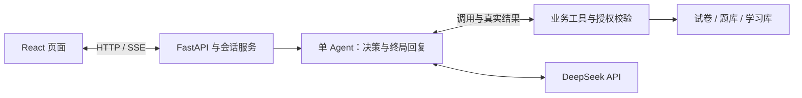

# 河海大学考试复习助手

面向河海大学学生的本地 AI 全栈应用：通过自然语言查找真实试卷、学习 Python 真题、获取图文辅导，并保存练习、错题和学习记忆。

项目地址：[minimaod/hhu-exam-agent](https://github.com/minimaod/hhu-exam-agent)。

**当前为本地原型，尚未部署在线服务。** 截至 2026-11-07，F010 A–D 已完成技术收尾，统一用户体验验收待完成；F010 改动尚未提交和推送。

## 能做什么

| 能力 | 当前范围 |
| --- | --- |
| 查卷与下载 | 按课程和考试类型查询真实目录，按登记 ID 下载本地 PDF |
| Python 真题 | 按内容检索、按卷和题型浏览、定位题号、回看来源与按需查看答案 |
| 图文辅导 | 输入文字、上传或粘贴题图，讲解、追问和纠正题目 |
| 类似题练习 | 按需生成练习，保存作答、评价、补充与订正 |
| 错题与会话 | 主动保存错题，恢复历史会话和已保存操作 |
| 学习记忆 | 跨会话查看学习证据与复习建议，支持纠正和持续移除 |

例如，在同一会话中先说“我要复习 Python”，再要求“找一道循环选择真题”。选题后可以继续“只给提示”“讲解这道题”“保存这题，再来一道类似题”。

目录现有 **13 门课程、162 条记录**，见 [catalog.json](data/papers/catalog.json)。本地 Python 题库有 **1152 道已批准发布题**，另 2 道异常题隔离；其余课程目前以试卷目录与下载为主。AI 生成的类似题不作为原卷真题。

## 技术与结构

- 前端：React、TypeScript、Vite、Tailwind CSS。
- 后端：Python 3.12、FastAPI、Pydantic、SQLite。
- Agent：LangGraph、DeepSeek 原生工具调用。
- 真题检索：SQLite 事实库、BM25、本地 BGE 向量与 Qdrant、RRF 融合排序。



模型选择下一步，程序校验目标、版本与操作条件并执行业务。终局正文由同一调度器生成，仍可能额外调用一次模型。浏览器不持有模型密钥，也不直接访问数据库或磁盘。Qdrant 使用本地存储模式，无需另启服务器。

## 本地运行

环境：Python 3.12、Node.js 24、uv、pnpm。依赖分别由 [uv.lock](uv.lock) 和 [pnpm-lock.yaml](frontend/pnpm-lock.yaml) 锁定。

先将 [.env.example](.env.example) 复制为项目根目录的 `.env`，填写自己的配置：

```dotenv
DEEPSEEK_API_KEY=your-api-key-here
DEEPSEEK_BASE_URL=https://api.deepseek.com
DEEPSEEK_MODEL=deepseek-flash
```

模型名以本地配置为准。环境变量优先，修改配置后重启后端；真实密钥不要放入前端或提交到仓库。

在项目根目录启动后端：

```powershell
uv sync
uv run uvicorn app.main:app --reload --host 127.0.0.1 --port 8000
```

另开终端启动前端：

```powershell
cd frontend
pnpm install --frozen-lockfile
pnpm dev
```

打开 [本地页面](http://127.0.0.1:5173)；接口说明见 [OpenAPI](http://127.0.0.1:8000/docs)。Vite 将 `/api` 转发到后端 8000 端口，这只是开发配置。

### 数据准备

| 运行范围 | 所需资料 |
| --- | --- |
| 查询目录 | 仓库自带的 `data/papers/catalog.json` |
| 下载原卷 | 按目录 `file_path` 准备对应 PDF；缺文件时返回 404 |
| 图文辅导与练习 | 有效模型配置，以及用户提供的题目材料 |
| Python 真题 | 已构建并审核发布的题库、索引、模型缓存和匹配的来源 PDF |

**克隆源码不会获得 PDF 或本地题库，只补 PDF 也不会自动生成已审核题目。** 题库工具位于 [tools/question_bank](tools/question_bank)，准备流程为抽取、校订审核、构建校验和发布。

学习库默认为 `data/local/study.sqlite3`，图片在 `data/local/attachments`，题库在 `data/local/question-bank`。可通过进程环境变量 `HHU_STUDY_DB`、`HHU_QB_ROOT` 指向独立数据。学习库当前为 v6，兼容旧库逐级迁移；升级前备份数据库与附件。不要用删除整个 `data/local` 的方式重置学习记录。

## 验证与当前限制

2026-11-07 收尾记录：后端完整回归 **993 passed**、离线外连 0；前端类型检查与构建通过；48 例新接口契约对照 **93/96**。新契约成绩与旧冻结脚本诊断分别计分，不能互相替代。本次文档整理未重跑这些测试。

- 相对学年筛选仍有已知失败；服务器取消链、前端刷新回执仍缺完整证据。
- 实模 S2 部分通过，未取得目标题 ID；S4 缺陷经专项复验关闭，不代表所有自然表达均已验证。
- 当前没有多用户登录与隔离、复习日历、每日计划或公开部署。
- 完整测试依赖本地 PDF、题库及冻结评测资料；涉及题库时使用独立副本，避免 Qdrant 目录锁冲突。
- 已有实模评测预算用尽，不直接重跑实模脚本；新增调用需单独确定范围与费用。

常规检查：项目根目录执行 `uv run pytest tests -q`；前端目录执行 `pnpm test`、`pnpm typecheck`、`pnpm build`。缺少本地资料时不能期待完整回归通过。

## 资料贡献与参考

补充资料前先核对 [目录](data/papers/catalog.json) 中的课程版本、学年、学期和卷别。可通过 [Issue](https://github.com/minimaod/hhu-exam-agent/issues/new) 提供资料来源、更正依据或补充信息，维护者核对后确认交接方式；不确定的信息标为待确认。

源码仓库不包含 PDF、个人学习数据、真实密钥及内部学习文档。目录记录不代表文件已公开提供。

参考项目：[ecommerce-query-agent](https://github.com/minimaod/ecommerce-query-agent)（前后端分层、SSE 与 Agent 组织）、[deepsearch-agents](https://github.com/didilili/deepsearch-agents)（Python 与工作流组织）。实际引用代码应保留对应来源及许可证。
