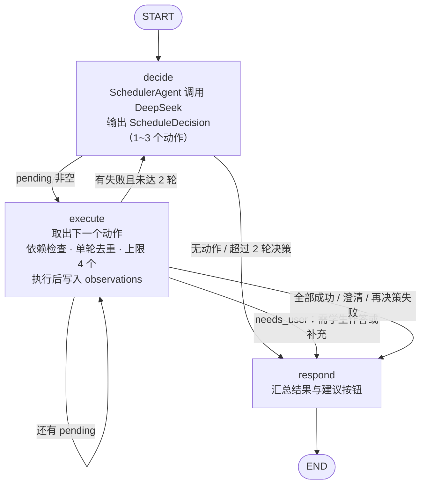
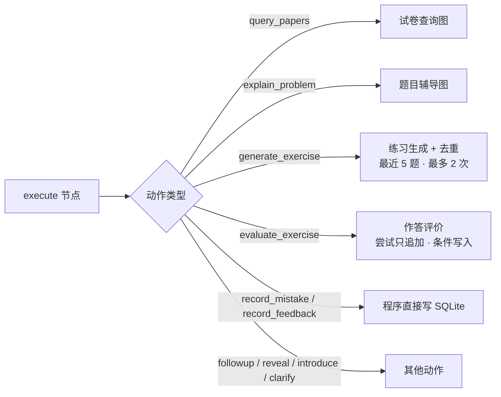
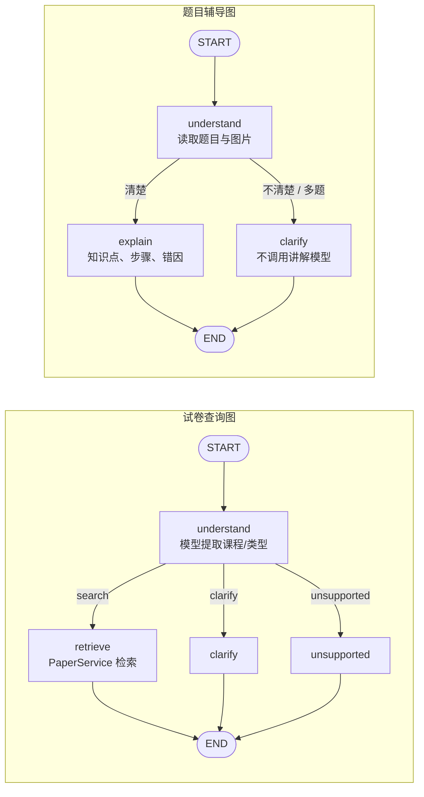

# 河海大学考试复习助手

面向河海大学学生、基于 LangGraph 调度 Agent 的考试复习助手：在同一个会话里用自然语言查真题、讲题、按需练习和整理错题。Agent 根据学生发言和会话上下文规划动作，由程序执行检索、保存与校验，并把真实执行结果反馈给 Agent 继续决策。

项目地址：[minimaod/hhu-exam-agent](https://github.com/minimaod/hhu-exam-agent)

**当前为本地运行的最小版本，尚未部署在线服务。仓库提供源码、试卷目录和运行说明；真实试卷 PDF 与 API 密钥需自行准备。**

## 功能与边界

- 自然语言查询：一次查询一门课程，支持期中、期末或全部类型。
- 统一学习会话：新建、切换和恢复会话；会话可查试卷，也可提交文字/图片题目、自己的答案和解法。会话页采用聊天式布局：历史消息在独立区域上下滚动，输入框固定在底部，不随消息滚动。
- 题目辅导：题目不清楚时先请求补充；清楚后展示知识点、步骤、最终答案；有学生解法时分析具体错误。
- 来源可选：可从会话中的查询结果选择已登记试卷；学生自述来源单独标注“未核实”，不从图片猜试卷或题号。
- 错题本：只有明确“记录这题”或点击记录按钮才建立正式记录；可回看题目、图片、来源、讲解、追问和反馈，并纠正或删除记录。
- 会话自动保存：每轮输入、结果和执行状态保存到本地 SQLite；刷新页面或重启后端后仍可查看，可围绕当前题目继续追问。
- 手动筛选与下载：按课程名称或别名、考试类型查询；通过登记 ID 定位本地 PDF，保留文件名，显示下载错误。
- 动态练习：在会话中按需生成类似题（参考最近题目去重）；答案与解题过程分开填写，评价后可订正或补充，每次作答独立保留；看过参考解答后作答会如实标注“不代表独立掌握”。
- 动态调度：一句话可组合多个动作（如“保存这题，再来一道类似题”）；已确认的课程、当前题目和练习在后续轮次中继承；建议按钮只在当前有效时显示。
- 失败可恢复：业务结果区分成功、部分完成、未完成、待补充；失败轮次可从原轮次重试，已成功的动作不重做。
- 模型只做意图规划、题目整理、讲解、出题与评价；是否记录、来源校验、保存和“已保存/已记录”提示由程序执行。

当前不支持年份或学年筛选、精确课程版本筛选、长期学习进度记忆与掌握度评估、题型统计和个性化复习计划。不提供会话删除；删除错题记录只删除记录和修订，保留原会话与图片。

## Agent 设计

项目的核心是一个基于 LangGraph 的 **“决策 → 执行 → 观察 → 再决策”调度 Agent**（`app/conversations/graph.py`）。学生在同一个会话里自然说话，Agent 判断要查试卷、讲题、出练习、评价作答还是记错题，并按需组合多个动作。

### 设计原则：模型做决策，程序管事实

| 由模型负责 | 由程序负责 |
| --- | --- |
| 理解意图、规划 1~3 个动作、写讲解与评价、生成练习题 | 校验动作参数与依赖、检索试卷目录、写入 SQLite、错题记录、“已保存/已记录”提示 |

模型输出必须是受 Pydantic 约束的 JSON（`ScheduleDecision`，`extra="forbid"`），不合格即视为失败；模型无法直接写库，也不能声称某份试卷“不存在”——目录事实只来自真实查询结果。

### LangGraph 图

**图 1：调度 Agent 主图**（`DynamicReviewGraph`，`app/conversations/graph.py`）



**图 2：动作与子工作流的调用关系**



**图 3：子工作流**（`app/querying/workflow.py`、`app/tutoring/workflow.py`）



### 动作工具箱

| 动作 | 作用 | 前置依赖 |
| --- | --- | --- |
| `introduce` | 确认课程，介绍能力并建议下一步 | — |
| `query_papers` | 调用试卷检索（课程别名归一、考试类型） | — |
| `explain_problem` | 题目讲解（新题 / 补充 / 纠正三种模式） | — |
| `followup_problem` | 回答对当前题的追问 | 题目已讲解 |
| `generate_exercise` | 按需生成类似练习题（去重） | 题目已讲解 |
| `evaluate_exercise` | 评价学生作答 | 存在练习 |
| `reveal_solution` | 展示参考解答 | 存在练习 |
| `record_mistake` | 保存到错题本 | 题目已讲解 |
| `record_feedback` | 记录“我懂了”等自述 | — |
| `clarify_or_reply` | 澄清歧义、接受拒绝、寒暄 | — |

### 可控性护栏

- **有界循环**：每轮最多决策 2 次、每次最多规划 3 个动作、累计最多执行 4 个；超出的动作标为“未执行”，不会被当作已完成。
- **依赖检查**：前置动作失败时，依赖它的动作自动跳过并说明原因（例如纠正失败后不再出题）。
- **单轮去重**：有副作用的动作在一轮内最多尝试一次，重新决策时也不会重复保存或重复出题。
- **观察驱动的再决策**：动作失败后把执行结果回传给模型重新决策；需要学生回答时立即结束本轮，等待输入。
- **行为红线**（写在提示词中并由测试覆盖）：“我懂了”只记录反馈，不会自动出题或存错题；“好”“可以”等歧义回答先澄清；学生说“不用了”不再推荐；未指定考试类型时不默认期末。
- **上下文继承**：已确认课程、当前题目和练习状态持久化保存，例如“给我期末试卷”会沿用上一轮确认的课程。
- **纯图片输入**由程序判断：当前有待作答练习时视为作答，否则视为新题。

### 练习闭环（出题 → 作答 → 评价 → 订正）

- 每次作答在 `exercise_attempts` 表中**只追加、不覆盖**，分为首次、补充、订正三种；评价写入时检查该作答是否已有评价，迟到或重复的响应不会覆盖已有结果。
- 看过参考解答后再作答，评价强制标注 `after_reveal`，说明“答案正确不代表独立掌握”。
- 生成练习时参考最近 5 道题避免重复，最多生成 2 次；仍重复则如实说明，不保存。

### 可靠性：Agent 中途失败怎么办

- 每轮先写入 `running` 状态再执行；结果先落库，再通过 SSE 推送给前端。
- 同一个 `request_id` 重复提交时直接回放已保存结果，不会再次调用模型。
- 失败后使用 `retry_of` 重试：服务端按原计划的检查点恢复，**已成功的动作不重做**，只重新执行失败及依赖它的动作。
- 运行状态（running / completed / failed / interrupted）与业务结果（成功 / 部分完成 / 未完成 / 待补充）分开记录，部分完成时已有结果仍会展示。
- 后端重启时，遗留的进行中轮次标记为“已中断”，不会自动重新调用模型。

## 资料目录

目录快照（2026-10-25），共登记 **13 门课程、162 份试卷**。贡献前可展开对应课程，按完整题名中的学期、课程版本和卷别对照，避免重复。

| 课程大类 | 全部 | 期中 | 期末 | 其他 |
| --- | --- | --- | --- | --- |
| 高等数学 | 14 | 7 | 7 | 0 |
| 概率论与数理统计 | 12 | 6 | 6 | 0 |
| 几何与线性代数 | 33 | 5 | 28 | 0 |
| 复变函数与积分变换 | 12 | 1 | 11 | 0 |
| 离散数学 | 5 | 0 | 5 | 0 |
| 大学物理 | 13 | 6 | 7 | 0 |
| C语言程序设计 | 9 | 5 | 4 | 0 |
| Python语言程序设计 | 20 | 10 | 10 | 0 |
| 中国近现代史纲要 | 11 | 0 | 11 | 0 |
| 大学英语 | 5 | 1 | 4 | 0 |
| 思想道德与法治 | 7 | 0 | 7 | 0 |
| 马克思主义基本原理 | 11 | 0 | 11 | 0 |
| 转专业 | 10 | 0 | 0 | 10 |
| 合计 | 162 | 41 | 111 | 10 |

完整机器可读目录：[catalog.json](data/papers/catalog.json)。课程按大类归并，“高数”“线代”“复变”“大物”等别名由 `app/papers/courses.py` 处理。A/B、Ⅰ/Ⅱ 等版本主要保留在标题中，当前不提供精确版本筛选；上下册等附加条件仍受自然语言支持范围限制。

**收录和标注口径：**

- 以下 162 条来自已登记目录，不是完整的历年考试清单；未列出表示当前未登记，不表示对应考试一定存在。
- “题名标注附答案”仅根据目录题名判断，未逐份核验答案完整性；“题名未标注”不等于确定没有答案。
- 考试类型沿用目录字段。题名只写“课内考试”“考试卷”或未写期末，但目录归为期末的，标记“期末（待核对）”，欢迎提供分类依据。
- 部分高数题名写的是“2014级”等入学年级，保留原题名；这些记录的目录学年标记待核对，不把年级直接认定为考试学年。
- “转专业”与高等数学、几何与线性代数等课程平级；它不是考试类型，这 10 份试卷的类型记为“其他”，因此期中、期末筛选不会混入转专业卷。
- 本地另有 7 份未登记资料，单列在“待整理资料”中，不计入 162 条，不直接视为缺失。

**目录记录不等于文件已经公开提供。** 仓库不包含 PDF。运行者需按 `file_path` 准备本地文件，或维护与自己资料一致的目录；未准备对应文件时，下载返回 404。

### 已登记试卷明细

<details>
<summary>高等数学：14 份（期中 7 / 期末 7）</summary>

| 目录学年 | 目录考试类型 | 完整题名（含学期、版本及卷别） | 答案标注 |
| --- | --- | --- | --- |
| 2024-2025 | 期末 | 2024-2025学年第二学期《高等数学AⅡ》期末考试试题 | 题名未标注 |
| 2024-2025 | 期末 | 2024-2025学年第一学期《高等数学BⅠ》期末试题及答案 | 题名标注附答案 |
| 2022-2023 | 期中 | 2022-2023学年第一学期《高等数学BⅠ》期中试卷 | 题名未标注 |
| 2021-2022 | 期中 | 2021-2022学年第一学期《高等数学BⅠ》期中试卷 | 题名未标注 |
| 2018-2019（待核对） | 期中 | 2018级高等数学（上）期中试卷 | 题名未标注 |
| 2018-2019（待核对） | 期末 | 2018级高等数学（上）期末试卷 | 题名未标注 |
| 2017-2018（待核对） | 期中 | 2017级高等数学（上）期中试卷 | 题名未标注 |
| 2017-2018（待核对） | 期末 | 2017级高等数学（上）期末试卷 | 题名未标注 |
| 2016-2017（待核对） | 期中 | 2016级高等数学（上）期中试卷 | 题名未标注 |
| 2016-2017（待核对） | 期末 | 2016级高等数学（上）期末试卷 | 题名未标注 |
| 2015-2016（待核对） | 期中 | 2015级高等数学（上）期中试卷 | 题名未标注 |
| 2015-2016（待核对） | 期末 | 2015级高等数学（上）期末试卷 | 题名未标注 |
| 2014-2015（待核对） | 期中 | 2014级高等数学（上）期中试卷 | 题名未标注 |
| 2014-2015（待核对） | 期末 | 2014级高等数学（上）期末试卷 | 题名未标注 |

</details>

<details>
<summary>概率论与数理统计：12 份（期中 6 / 期末 6）</summary>

| 目录学年 | 目录考试类型 | 完整题名（含学期、版本及卷别） | 答案标注 |
| --- | --- | --- | --- |
| 2025-2026 | 期中 | 2025-2026学年第一学期《概率论与数理统计A》期中试卷 | 题名未标注 |
| 2024-2025 | 期中 | 2024-2025学年第一学期《概率论与数理统计A》期中试卷 | 题名未标注 |
| 2023-2024 | 期中 | 2023-2024学年第一学期《概率论与数理统计》期中试卷 | 题名未标注 |
| 2022-2023 | 期中 | 2022-2023学年第一学期《概率论与数理统计A》期中试卷及答案 | 题名标注附答案 |
| 2021-2022 | 期中 | 2021-2022学年第一学期《概率论与数理统计》期中试卷及答案 | 题名标注附答案 |
| 2021-2022 | 期末 | 2021-2022学年第一学期《概率论与数理统计A》期末试卷（A卷）及答案 | 题名标注附答案 |
| 2020-2021 | 期中 | 2020-2021学年第一学期《概率论与数理统计(A,B)》期中试卷 | 题名未标注 |
| 2020-2021 | 期末（待核对） | 2020-2021学年工科类《概率论与数理统计》试卷（含答案） | 题名标注附答案 |
| 2019-2020 | 期末（待核对） | 2019-2020学年工科类《概率论与数理统计》试卷（含答案） | 题名标注附答案 |
| 2019-2020 | 期末（待核对） | 2019-2020学年经管类《概率论与数理统计》试卷（含答案） | 题名标注附答案 |
| 2018-2019 | 期末（待核对） | 2018-2019学年工科类《概率论与数理统计》试卷（含答案） | 题名标注附答案 |
| 2018-2019 | 期末（待核对） | 2018-2019学年经管类《概率论与数理统计》试卷（含答案） | 题名标注附答案 |

</details>

<details>
<summary>几何与线性代数：33 份（期中 5 / 期末 28）</summary>

| 目录学年 | 目录考试类型 | 完整题名（含学期、版本及卷别） | 答案标注 |
| --- | --- | --- | --- |
| 2024-2025 | 期末 | 2024-2025学年第一学期《几何与线性代数》期末试卷 | 题名未标注 |
| 2023-2024 | 期中 | 2023-2024学年第二学期《几何与线性代数》期中试卷 | 题名未标注 |
| 2023-2024 | 期末 | 2023-2024学年第二学期《几何与线性代数》期末试卷（A卷）及答案 | 题名标注附答案 |
| 2022-2023 | 期中 | 2022-2023学年第二学期《几何与线性代数》期中试卷及答案 | 题名标注附答案 |
| 2022-2023 | 期末 | 2022-2023学年第二学期《几何与线性代数》期末试卷及答案 | 题名标注附答案 |
| 2020-2021 | 期中 | 2020-2021学年第二学期《几何与线性代数》期中试卷及答案 | 题名标注附答案 |
| 2020-2021 | 期中 | 2020-2021学年第一学期《几何与线性代数》期中试卷 | 题名未标注 |
| 2020-2021 | 期末 | 2020-2021学年第一学期《几何与线性代数》期末试卷及答案 | 题名标注附答案 |
| 2018-2019 | 期中 | 2018-2019学年第二学期《几何与线性代数》期中试卷（A卷）及答案 | 题名标注附答案 |
| 2018-2019 | 期末 | 2018-2019学年第二学期《几何与线性代数》期末试卷及答案 | 题名标注附答案 |
| 2017-2018 | 期末 | 2017-2018学年第二学期《几何与线性代数》期末试卷（A卷）及答案 | 题名标注附答案 |
| 2017-2018 | 期末（待核对） | 2017-2018学年第一学期《几何与线性代数》课内考试卷（A卷）及答案 | 题名标注附答案 |
| 2016-2017 | 期末（待核对） | 2016-2017学年第二学期《几何与线性代数》课内考试卷（A卷）及答案 | 题名标注附答案 |
| 2016-2017 | 期末 | 2016-2017学年第二学期《几何与线性代数》期末试卷（A卷）及答案 | 题名标注附答案 |
| 2016-2017 | 期末（待核对） | 2016-2017学年第一学期《几何与线性代数》课内考试卷（A卷）及答案 | 题名标注附答案 |
| 2015-2016 | 期末（待核对） | 2015-2016学年第二学期《几何与线性代数》考试卷（A卷）及答案 | 题名标注附答案 |
| 2015-2016 | 期末（待核对） | 2015-2016学年第二学期《几何与线性代数》课内考试卷（A卷）及答案 | 题名标注附答案 |
| 2015-2016 | 期末 | 2015-2016学年第二学期《几何与线性代数》期末试卷（A卷）及答案 | 题名标注附答案 |
| 2015-2016 | 期末（待核对） | 2015-2016学年第一学期《几何与线性代数》课内考试卷（A卷）及答案 | 题名标注附答案 |
| 2014-2015 | 期末（待核对） | 2014-2015学年第二学期《几何与线性代数》课内考试卷（A卷）及答案 | 题名标注附答案 |
| 2014-2015 | 期末 | 2014-2015学年第二学期《几何与线性代数》期末试卷（A卷）及答案 | 题名标注附答案 |
| 2013-2014 | 期末（待核对） | 2013-2014学年第二学期《几何与线性代数》课内考试卷（A卷）及答案 | 题名标注附答案 |
| 2013-2014 | 期末 | 2013-2014学年第二学期《几何与线性代数》期末试卷及答案 | 题名标注附答案 |
| 2013-2014 | 期末（待核对） | 2013-2014学年第一学期《几何与线性代数》课内考试卷（A卷）及答案 | 题名标注附答案 |
| 2012-2013 | 期末 | 2012-2013学年第二学期《几何与线性代数》期末试卷（A卷）及答案 | 题名标注附答案 |
| 2012-2013 | 期末（待核对） | 2012-2013学年第一学期《几何与线性代数》课内考试卷（A卷）及答案 | 题名标注附答案 |
| 2011-2012 | 期末 | 2011-2012学年第二学期《几何与线性代数》期末试卷（A卷）及答案 | 题名标注附答案 |
| 2010-2011 | 期末 | 2010-2011学年第二学期《几何与线性代数》期末试卷及答案 | 题名标注附答案 |
| 2009-2010 | 期末 | 2009-2010学年第二学期《几何与线性代数》期末试卷及答案 | 题名标注附答案 |
| 2008-2009 | 期末 | 2008-2009学年第二学期《几何与线性代数》期末试卷及答案 | 题名标注附答案 |
| 2007-2008 | 期末 | 2007-2008学年第二学期《几何与线性代数》期末试卷及答案 | 题名标注附答案 |
| 2006-2007 | 期末 | 2006-2007学年第二学期《几何与线性代数》期末试卷及答案 | 题名标注附答案 |
| 2005-2006 | 期末 | 2005-2006学年第二学期《几何与线性代数》期末试卷及答案 | 题名标注附答案 |

</details>

<details>
<summary>复变函数与积分变换：12 份（期中 1 / 期末 11）</summary>

| 目录学年 | 目录考试类型 | 完整题名（含学期、版本及卷别） | 答案标注 |
| --- | --- | --- | --- |
| 2021-2022 | 期中 | 2021-2022学年第二学期《复变函数与积分变换》期中试卷及答案 | 题名标注附答案 |
| 2021-2022 | 期末 | 2021-2022学年第一学期《复变函数与积分变换A》期末试卷（B卷）及答案 | 题名标注附答案 |
| 2020-2021 | 期末 | 2020-2021学年第一学期《复变函数与积分变换》期末试卷（A卷）及答案 | 题名标注附答案 |
| 2016-2017 | 期末 | 2016-2017学年第一学期《复变函数与积分变换B》期末试卷（A卷）及答案 | 题名标注附答案 |
| 2015-2016 | 期末 | 2015-2016学年第二学期《复变函数与积分变换》期末试卷（A卷）及答案 | 题名标注附答案 |
| 2015-2016 | 期末 | 2015-2016学年第一学期《复变函数与积分变换》期末试卷（A卷）及答案 | 题名标注附答案 |
| 2014-2015 | 期末 | 2014-2015学年第二学期《复变函数与积分变换B》期末试卷（A卷）及答案 | 题名标注附答案 |
| 2014-2015 | 期末 | 2014-2015学年第一学期《复变函数与积分变换》期末试卷（A卷）及答案 | 题名标注附答案 |
| 2014-2015 | 期末 | 2014-2015学年第一学期《复变函数与积分变换》期末试卷（B卷）及答案 | 题名标注附答案 |
| 2013-2014 | 期末 | 2013-2014学年第一学期《复变函数与积分变换》期末试卷（A卷）及答案 | 题名标注附答案 |
| 2013-2014 | 期末 | 2013-2014学年第一学期《复变函数与积分变换》期末试卷（B卷） | 题名未标注 |
| 2003-2004 | 期末 | 2003-2004学年第二学期《复变函数与积分变换》期末试卷（B卷） | 题名未标注 |

</details>

<details>
<summary>离散数学：5 份（期中 0 / 期末 5）</summary>

| 目录学年 | 目录考试类型 | 完整题名（含学期、版本及卷别） | 答案标注 |
| --- | --- | --- | --- |
| 2022-2023 | 期末 | 2022-2023学年第一学期《离散数学》期末试卷 | 题名未标注 |
| 2020-2021 | 期末 | 2020-2021学年第一学期《离散数学》期末试卷（A卷） | 题名未标注 |
| 2020-2021 | 期末 | 2020-2021学年第一学期《离散数学》期末试卷（C卷）及答案 | 题名标注附答案 |
| 2019-2020 | 期末 | 2019-2020学年第一学期《离散数学》期末试卷（B卷） | 题名未标注 |
| 2018-2019 | 期末 | 2018-2019学年第一学期《离散数学》期末试卷（B卷） | 题名未标注 |

</details>

<details>
<summary>大学物理：13 份（期中 6 / 期末 7）</summary>

| 目录学年 | 目录考试类型 | 完整题名（含学期、版本及卷别） | 答案标注 |
| --- | --- | --- | --- |
| 2024-2025 | 期中 | 2024-2025学年第二学期《大学物理AI》期中试卷 | 题名未标注 |
| 2023-2024 | 期中 | 2023-2024学年第二学期《大学物理AI》期中试卷及答案 | 题名标注附答案 |
| 2022-2023 | 期末 | 2022-2023学年第一学期《大学物理AII》期末试卷 | 题名未标注 |
| 2021-2022 | 期中 | 2021-2022学年第一学期《大学物理AII》期中试卷及答案 | 题名标注附答案 |
| 2020-2021 | 期中 | 2020-2021学年第二学期《大学物理AI》期中试卷 | 题名未标注 |
| 2020-2021 | 期中 | 2020-2021学年第一学期《大学物理AI》期中试卷（力学综合测试） | 题名未标注 |
| 2020-2021 | 期中 | 2020-2021学年第一学期《大学物理AII》期中试卷及答案 | 题名标注附答案 |
| 2020-2021 | 期末 | 2020-2021学年第一学期《大学物理II》期末试卷（A卷）及答案 | 题名标注附答案 |
| 2019-2020 | 期末 | 2019-2020学年第一学期《大学物理II》期末试卷（A卷）及答案 | 题名标注附答案 |
| 2018-2019 | 期末 | 2018-2019学年第二学期《大学物理BI》期末试卷（A卷）及答案 | 题名标注附答案 |
| 2017-2018 | 期末 | 2017-2018学年第二学期《大学物理BI》期末试卷（A卷）及答案 | 题名标注附答案 |
| 2017-2018 | 期末 | 2017-2018学年第一学期《大学物理II》期末试卷（A卷）及答案 | 题名标注附答案 |
| 2014-2015 | 期末 | 2014-2015学年第一学期《大学物理II》期末试卷（A卷）及答案 | 题名标注附答案 |

</details>

<details>
<summary>C语言程序设计：9 份（期中 5 / 期末 4）</summary>

| 目录学年 | 目录考试类型 | 完整题名（含学期、版本及卷别） | 答案标注 |
| --- | --- | --- | --- |
| 2023-2024 | 期末 | 2023-2024学年第一学期《C语言程序设计》期末试卷（A卷）及答案 | 题名标注附答案 |
| 2022-2023 | 期中 | 2022-2023学年第一学期《C语言程序设计》期中试卷及答案 | 题名标注附答案 |
| 2022-2023 | 期末 | 2022-2023学年第二学期《C语言程序设计》期末试卷（A卷） | 题名未标注 |
| 2021-2022 | 期中 | 2021-2022学年第一学期《C语言程序设计》期中试卷及答案 | 题名标注附答案 |
| 2021-2022 | 期末 | 2021-2022学年第二学期《C语言程序设计》期末试卷（A卷）及答案 | 题名标注附答案 |
| 2020-2021 | 期中 | 2020-2021学年第一学期《C语言程序设计》期中试卷及答案 | 题名标注附答案 |
| 2020-2021 | 期末 | 2020-2021学年第二学期《C语言程序设计》期末试卷（A卷）及答案 | 题名标注附答案 |
| 2019-2020 | 期中 | 2019-2020学年第一学期《C语言程序设计》期中试卷及答案 | 题名标注附答案 |
| 2018-2019 | 期中 | 2018-2019学年第一学期《C语言程序设计》期中试卷及答案 | 题名标注附答案 |

</details>

<details>
<summary>Python语言程序设计：20 份（期中 10 / 期末 10）</summary>

| 目录学年 | 目录考试类型 | 完整题名（含学期、版本及卷别） | 答案标注 |
| --- | --- | --- | --- |
| 2024-2025 | 期末 | 2024-2025学年第一学期《Python语言程序设计》期末试卷（A卷）及答案 | 题名标注附答案 |
| 2024-2025 | 期中 | 2024-2025学年第一学期《Python语言程序设计》期中试卷及答案 | 题名标注附答案 |
| 2024-2025 | 期末 | 2024-2025学年第二学期《Python语言程序设计》期末试卷（A卷）及答案 | 题名标注附答案 |
| 2024-2025 | 期中 | 2024-2025学年第二学期《Python语言程序设计》期中试卷及答案 | 题名标注附答案 |
| 2023-2024 | 期末 | 2023-2024学年第一学期《Python语言程序设计》期末试卷（A卷）及答案 | 题名标注附答案 |
| 2023-2024 | 期中 | 2023-2024学年第一学期《Python语言程序设计》期中试卷及答案 | 题名标注附答案 |
| 2023-2024 | 期末 | 2023-2024学年第二学期《Python语言程序设计》期末试卷（A卷）及答案 | 题名标注附答案 |
| 2023-2024 | 期中 | 2023-2024学年第二学期《Python语言程序设计》期中试卷 | 题名未标注 |
| 2022-2023 | 期末 | 2022-2023学年第一学期《Python语言程序设计》期末试卷（A卷）及答案 | 题名标注附答案 |
| 2022-2023 | 期中 | 2022-2023学年第一学期《Python语言程序设计》期中试卷及答案 | 题名标注附答案 |
| 2022-2023 | 期末 | 2022-2023学年第二学期《Python语言程序设计》期末试卷（A卷）及答案 | 题名标注附答案 |
| 2022-2023 | 期中 | 2022-2023学年第二学期《Python语言程序设计》期中试卷及答案 | 题名标注附答案 |
| 2021-2022 | 期末 | 2021-2022学年第一学期《Python语言程序设计》期末试卷（A卷）及答案 | 题名标注附答案 |
| 2021-2022 | 期中 | 2021-2022学年第一学期《Python语言程序设计》期中试卷及答案 | 题名标注附答案 |
| 2021-2022 | 期末 | 2021-2022学年第二学期《Python语言程序设计》期末试卷（A卷）及答案 | 题名标注附答案 |
| 2021-2022 | 期中 | 2021-2022学年第二学期《Python语言程序设计》期中试卷及答案 | 题名标注附答案 |
| 2020-2021 | 期末 | 2020-2021学年第一学期《Python语言程序设计》期末试卷（A卷）及答案 | 题名标注附答案 |
| 2020-2021 | 期中 | 2020-2021学年第一学期《Python语言程序设计》期中试卷及答案 | 题名标注附答案 |
| 2020-2021 | 期末 | 2020-2021学年第二学期《Python语言程序设计》期末试卷（A卷）及答案 | 题名标注附答案 |
| 2020-2021 | 期中 | 2020-2021学年第二学期《Python语言程序设计》期中试卷及答案 | 题名标注附答案 |

</details>

<details>
<summary>中国近现代史纲要：11 份（期中 0 / 期末 11）</summary>

| 目录学年 | 目录考试类型 | 完整题名（含学期、版本及卷别） | 答案标注 |
| --- | --- | --- | --- |
| 2020-2021 | 期末 | 2020-2021学年第一学期《中国近现代史纲要》期末试卷（A卷）版本1 | 题名未标注 |
| 2020-2021 | 期末 | 2020-2021学年第一学期《中国近现代史纲要》期末试卷（A卷）版本2 | 题名未标注 |
| 2020-2021 | 期末 | 2020-2021学年第一学期《中国近现代史纲要》期末试卷（B卷） | 题名未标注 |
| 2019-2020 | 期末 | 2019-2020学年第一学期《中国近现代史纲要》期末试卷（A卷） | 题名未标注 |
| 2019-2020 | 期末 | 2019-2020学年第一学期《中国近现代史纲要》期末试卷（B卷） | 题名未标注 |
| 2018-2019 | 期末 | 2018-2019学年第一学期《中国近现代史纲要》期末试卷及答案（B卷） | 题名标注附答案 |
| 2018-2019 | 期末 | 2018-2019学年第一学期《中国近现代史纲要》期末试卷（C卷） | 题名未标注 |
| 2017-2018 | 期末 | 2017-2018学年第一学期《中国近现代史纲要》期末试卷（A卷） | 题名未标注 |
| 2016-2017 | 期末 | 2016-2017学年第一学期《中国近现代史纲要》期末试卷（A卷） | 题名未标注 |
| 2016-2017 | 期末 | 2016-2017学年第一学期《中国近现代史纲要》期末试卷（C卷） | 题名未标注 |
| 2016-2017 | 期末 | 2016-2017学年第二学期《中国近现代史纲要》期末试卷（A卷） | 题名未标注 |

</details>

<details>
<summary>大学英语：5 份（期中 1 / 期末 4）</summary>

| 目录学年 | 目录考试类型 | 完整题名（含学期、版本及卷别） | 答案标注 |
| --- | --- | --- | --- |
| 2023-2024 | 期中 | 2023-2024学年第二学期《大学英语II》期中试卷及答案 | 题名标注附答案 |
| 2023-2024 | 期末 | 2023-2024学年第二学期《大学英语II》期末试卷 | 题名未标注 |
| 2022-2023 | 期末 | 2022-2023学年第二学期《大学英语II》期末试卷及答案 | 题名标注附答案 |
| 2022-2023 | 期末 | 2022-2023学年第一学期《大学英语I》期末试卷及答案（A卷） | 题名标注附答案 |
| 2020-2021 | 期末 | 2020-2021学年第二学期《大学英语》期末试卷及答案（A卷） | 题名标注附答案 |

</details>

<details>
<summary>思想道德与法治：7 份（期中 0 / 期末 7）</summary>

| 目录学年 | 目录考试类型 | 完整题名（含学期、版本及卷别） | 答案标注 |
| --- | --- | --- | --- |
| 2023-2024 | 期末 | 2023-2024学年第一学期《思想道德与法治》期末试卷 | 题名未标注 |
| 2022-2023 | 期末 | 2022-2023学年第一学期《思想道德与法治》期末试卷 | 题名未标注 |
| 2020-2021 | 期末 | 2020-2021学年第二学期《思想道德与法治》期末试卷及答案（A卷） | 题名标注附答案 |
| 2019-2020 | 期末 | 2019-2020学年第二学期《思想道德与法治》期末试卷及答案（A卷） | 题名标注附答案 |
| 2019-2020 | 期末 | 2019-2020学年第一学期《思想道德与法治》期末试卷（C卷） | 题名未标注 |
| 2018-2019 | 期末 | 2018-2019学年第一学期《思想道德与法治》期末试卷及答案（B卷） | 题名标注附答案 |
| 2017-2018 | 期末 | 2017-2018学年第二学期《思想道德与法治》期末试卷及答案（B卷） | 题名标注附答案 |

</details>

<details>
<summary>马克思主义基本原理：11 份（期中 0 / 期末 11）</summary>

| 目录学年 | 目录考试类型 | 完整题名（含学期、版本及卷别） | 答案标注 |
| --- | --- | --- | --- |
| 2023-2024 | 期末 | 2023-2024学年第一学期《马克思主义基本原理》期末试卷（A卷） | 题名未标注 |
| 未标注 | 期末 | 《马克思主义基本原理概论》期末试卷及答案（第01套） | 题名标注附答案 |
| 未标注 | 期末 | 《马克思主义基本原理概论》期末试卷及答案（第02套） | 题名标注附答案 |
| 未标注 | 期末 | 《马克思主义基本原理概论》期末试卷及答案（第03套） | 题名标注附答案 |
| 未标注 | 期末 | 《马克思主义基本原理概论》期末试卷及答案（第04套） | 题名标注附答案 |
| 未标注 | 期末 | 《马克思主义基本原理概论》期末试卷及答案（第05套） | 题名标注附答案 |
| 未标注 | 期末 | 《马克思主义基本原理概论》期末试卷及答案（第06套） | 题名标注附答案 |
| 未标注 | 期末 | 《马克思主义基本原理概论》期末试卷及答案（第07套） | 题名标注附答案 |
| 未标注 | 期末 | 《马克思主义基本原理概论》期末试卷及答案（第08套） | 题名标注附答案 |
| 未标注 | 期末 | 《马克思主义基本原理概论》期末试卷及答案（第09套） | 题名标注附答案 |
| 未标注 | 期末 | 《马克思主义基本原理概论》期末试卷及答案（第10套） | 题名标注附答案 |

</details>

<details>
<summary>转专业：10 份（其他 10）</summary>

| 目录学年 | 目录考试类型 | 完整题名（含学期、版本及卷别） | 答案标注 |
| --- | --- | --- | --- |
| 2025 | 转专业 | 2025年河海大学转专业《专业综合测试（自动化）》试卷（回忆版） | 题名未标注 |
| 2024 | 转专业 | 2024年河海大学转专业《专业综合测试（计算机与软件学院）》面试真题汇总 | 题名未标注 |
| 2024 | 转专业 | 2024年河海大学转专业《大学英语》试卷（回忆版） | 题名未标注 |
| 2024 | 转专业 | 2024年河海大学转专业《高等数学》试卷（回忆版） | 题名未标注 |
| 2022 | 转专业 | 2022年河海大学转专业《大学语文》试卷（回忆版） | 题名未标注 |
| 2021 | 转专业 | 2021年河海大学转专业《大学英语》试卷 | 题名未标注 |
| 2021 | 转专业 | 2021年河海大学转专业《高等数学B（工科）》试卷 | 题名未标注 |
| 2019-2022 | 转专业 | 2019-2022级河海大学转专业《高等数学（上册）》真题精选及答案 | 题名标注附答案 |
| 2019 | 转专业 | 2019年河海大学转专业《高等数学B（工科）》试卷 | 题名未标注 |
| 未标注 | 转专业 | 河海大学转专业《大学英语》真题题源截图（选词填空与阅读） | 题名未标注 |

</details>

### 优先补充方向

下表基于当前目录，列出优先征集方向。各学期、课程版本和卷别仍需分别核对；未登记不代表确定存在一场缺失考试，也不代表同学年已有一份资料就覆盖所有版本。

| 课程 | 当前优先补充方向 |
| --- | --- |
| 高等数学 | 2023-2024 学年资料；2024-2025 学年期中资料 |
| 概率论与数理统计 | 2022-2023、2023-2024、2024-2025、2025-2026 学年期末资料 |
| 几何与线性代数 | 2021-2022 学年资料；2024-2025 学年期中资料 |
| 复变函数与积分变换 | 2022-2023 至 2025-2026 学年资料 |
| 离散数学 | 2023-2024 至 2025-2026 等近年资料；若课程有期中考核，也欢迎补充相应试卷 |
| 大学物理 | 2023-2024、2024-2025 学年期末资料 |
| C语言程序设计 | 2024-2025 学年资料；2019-2020 学年期末完整试卷（现只有参考答案） |
| Python语言程序设计 | 2025-2026 学年资料 |
| 中国近现代史纲要 | 2021-2022 至 2025-2026 学年资料；近年期中资料 |
| 大学英语 | 2024-2025、2025-2026 学年资料，完整卷优先 |
| 思想道德与法治 | 2024-2025、2025-2026 学年资料 |
| 马克思主义基本原理 | 近年期末完整卷；现有 10 套题库缺少学年，欢迎补充出处 |
| 转专业 | 近年完整真题；回忆版与截图欢迎补充原始试卷 |

也欢迎补充未覆盖的课程、其他学期或版本、不同卷别、配套答案和更清晰的扫描件。已有记录如有课程、学年、考试类型或题名错误，也可提供更正依据。

### 待整理资料

下列文件本地已有但尚未登记，文件内容、是否重复及配套关系仍待核对。请先提供核对线索，避免重复提交相同文件：

| 本地文件名 | 当前状态 |
| --- | --- |
| 2020-2021学年第二学期《几何与线性代数》期末试卷（A卷）参考答案.pdf | 纯参考答案、无题目页，未单独登记；配套试卷待核对 |
| 2019-2020学年第一学期《C语言程序设计》期末试卷（A卷）参考答案.pdf | 纯参考答案、无题目页，未单独登记；配套完整试卷待核对 |
| 2017-2018学年第二学期《大学物理BI》期末试卷（B卷）参考答案.pdf | 纯参考答案，同场 A 卷已登记；未单独登记 |
| 2025-2026学年第一学期《大学物理AII》期中试卷参考答案.pdf | 纯参考答案，未单独登记；配套试卷待核对 |
| 2011级河海大学新生英语入学分级考试试卷及答案.pdf | 新生分级考试，不属于期中/期末，未登记 |
| 2023-2024学年第一学期《大学英语I》期末试卷（节选）.pdf | 节选缺页，未登记；收到完整卷后再补 |
| 河海大学《思想道德修养与法律基础》期末试卷.pdf | 旧课程名且无学年，未登记；确认学年后可按“思想道德与法治”补录 |

### 如何贡献资料

1. 先展开上述明细，核对课程版本、学年、学期、考试类型与卷别。
2. 通过仓库 [新建 Issue](https://github.com/minimaod/hhu-exam-agent/issues/new) 提供资料信息，标题可用“资料补充：课程 / 学年 / 考试类型”；更正已有资料时请附完整题名。
3. 维护者核对是否已收录及资料信息后，再确认 PDF 的具体交接方式。本仓库继续只提交源码和目录，不要求把 PDF 加入 Git 提交。

可复制以下内容填写；不确定的项目写“待确认”，无需猜测：

```text
课程及版本：
学年、学期：
考试类型、卷别：
是否附答案：
资料来源及可提供方式：
对应已有题名或补充说明：
```

## 技术栈与架构

- 前端：React 19、TypeScript、Vite、Tailwind CSS。
- 后端：Python 3.12、FastAPI、Pydantic、Uvicorn。
- 模型与流程：DeepSeek 官方接口、LangChain 模型适配、LangGraph 工作流。
- 数据：JSON 试卷目录、本地 PDF，以及 `data/local/study.sqlite3` 中的会话、题目、附件和错题记录。
- 通信：普通 HTTP 用于会话管理、图片、错题本与下载，SSE 反馈查询/辅导进度和最终结果。

```text
React 页面
  ├─ 新建/切换会话 → FastAPI → 会话服务 → SQLite（会话、轮次、题目、附件）
  ├─ 统一输入（文字/图片/练习作答）→ FastAPI → 会话服务
  │                            ├─ 先写入 running 轮次并绑定附件
  │                            ├─ 调度 Agent（LangGraph）：decide → execute → 观察 → 再决策；动作含查卷/讲题/追问/出题/评价/看解答/记录/反馈
  │                            ├─ 查询：LangGraph + DeepSeek 提取条件 → 程序检索
  │                            ├─ 辅导：题目理解 → 清晰度检查 → 澄清或讲解
  │                            ├─ 练习：生成去重 → 作答尝试只追加 → 评价条件写入
  │                            ├─ 结果与恢复检查点先保存，再通过 SSE 返回
  │                            └─ 记录动作由程序写入错题本
  │                   ← SSE 进度和最终结果
  ├─ 错题本 → FastAPI → 记录服务 → SQLite（记录、修订、附件关联）
  ├─ 手动筛选 → FastAPI → PaperService → PaperRepository
  └─ 下载 → FastAPI → 根据登记 ID 检查路径及文件 → 返回 PDF
```

查询仍是一次模型理解加程序检索；辅导先整理题目并判断清晰度，不清楚时不调用讲解模型。调度 Agent 每次决策只接收持久上下文摘要（已确认课程、当前题目/练习状态、最近几轮摘要和本轮已执行结果），不会发送全部会话历史。未配置调度器时，保留旧版单次意图路由作为兼容路径。

后端目录：

```text
app/
├─ main.py          # 应用组装、启动配置、数据库初始化和统一异常处理
├─ config.py        # 模型配置及启动快照
├─ llm.py           # DeepSeek 模型构造、错误映射与响应读取
├─ sse.py           # 统一 SSE 编码
├─ streaming.py     # 查询/辅导共用的超时、断流与取消运行器
├─ images.py        # 图片解码校验、原子写入与读取
├─ api/             # 健康检查、试卷、查询、会话、附件与错题接口
├─ conversations/   # 会话契约、v4 结构/迁移、调度 Agent（graph.py）、兼容意图路由、SQLite 仓库与服务
├─ tutoring/        # 辅导契约、提示词、图文模型适配、LangGraph、练习生成/评价（exercise_llm.py）与去重（exercise_dedup.py）
├─ mistakes/        # 错题记录契约、创建/回看/纠正/删除服务
├─ papers/          # 试卷模型、别名、仓库、业务服务与异常
└─ querying/        # 理解契约、提示词、模型适配、工作流与查询事件
frontend/
├─ src/components/  # 会话工作区/轮次/输入、练习主卡与作答回执、错题本、筛选、结果与试卷卡片
├─ src/lib/         # HTTP 请求、会话/辅导/记录 SSE 解析、响应校验、下载、展示规则（display.ts）
└─ vite.config.ts   # 本地开发端口及 /api 代理
data/papers/
└─ catalog.json     # 已登记资料；PDF 不随仓库提供
data/local/         # 本地数据库、图片与演示数据；已被忽略，不进入仓库
tests/              # 后端契约、迁移、图片、模型替身及真实资料测试
```

## 本地启动

### 环境

项目已使用 Python 3.12.13、Node.js 24.21.0、pnpm 12.5.1、uv 0.11.14 进行本地验证。依赖由 `uv.lock` 和 `frontend/pnpm-lock.yaml` 锁定。

### 1. 准备模型配置

复制项目根目录的 `.env.example` 为 `.env`，在本地填入 DeepSeek 密钥：

```dotenv
DEEPSEEK_API_KEY=your-api-key-here
DEEPSEEK_BASE_URL=https://api.deepseek.com
DEEPSEEK_MODEL=deepseek-flash
```

- 默认模型为 `deepseek-flash`，使用 JSON Output 并关闭思考模式。
- 配置在后端启动时读取，已有环境变量优先；修改 `.env` 后需重启后端。
- 密钥仅供后端读取，不放入前端 `VITE_*` 变量。
- 缺少或错误配置不阻止健康检查、手动查询和会话历史；提交新的自然语言轮次时返回 503。
- `.env` 已被忽略，示例配置只含占位值。

### 2. 启动后端

在项目根目录运行：

```powershell
uv sync
uv run uvicorn app.main:app --reload --host 127.0.0.1 --port 8000
```

接口文档：<http://127.0.0.1:8000/docs>。

### 3. 启动前端

另开终端：

```powershell
cd frontend
pnpm install
pnpm dev
```

浏览器打开 <http://127.0.0.1:5173>。Vite 在开发时将 `/api` 请求代理到 `http://127.0.0.1:8000`；生产部署入口需另行配置。

### 4. 准备 PDF

按 `data/papers/catalog.json` 中的 `file_path`，在 `data/papers/` 下创建对应子目录并放入 PDF。PDF、密钥、依赖目录、构建产物与缓存不进入版本控制。

### 5. 本地会话数据

首次启动后端时，会在项目根目录创建 `data/local/study.sqlite3` 保存会话、轮次、题目和错题记录；题目图片保存在 `data/local/attachments/`（可能同时出现数据库的 `-wal`、`-shm` 附属文件）。整个 `data/local/` 已被忽略，不进入版本控制，也不会上传。

- 旧版数据库启动时会按 v1→v2→v3→v4 在单个事务内逐级自动升级，保留原会话、轮次、题目与练习（旧练习回填为第 1 次作答）；升级失败会回滚并返回 503，不删除、不覆盖原文件。升级前建议停止后端并自行备份整个 `data/local/`。
- 修改或删除数据库前先停止后端；需要重置本地数据时删除整个 `data/local/` 目录即可，这会同时丢失已有会话、错题和图片。
- 会话与错题历史保存在本机，换浏览器或换设备不会同步。
- 数据库损坏或结构版本不兼容时，会话/辅导/错题接口返回 503，健康检查、手动筛选和下载仍可用；程序不会自动清空或覆盖原文件。
- 后端启动时会把上次遗留的“进行中”轮次标记为已中断，不会自动重新调用模型；超过 24 小时且没有被任何轮次/题目使用的待提交图片会被清理。
- 删除错题记录只删除记录、修订和关联行，保留原会话和图片；本版本没有会话删除功能。

### 6. 图片限制

- 支持 JPEG、PNG、GIF、WebP，按真实文件内容识别，不信任扩展名或声明的 MIME。
- 单张不超过 6 MiB；一轮最多 4 张、合计不超过 20 MiB；单边不超过 8192 像素、总像素不超过 4000 万。
- 图片只能通过会话附件接口读取，接口校验会话归属，不返回磁盘路径。
- 上传后未提交的附件 24 小时后清理；已提交附件随会话保留。彻底清空需停止后端后删除 `data/local/`。

## 使用示例

- 打开页面后先新建会话，再输入“我要复习高数”：查询高等数学大类的已登记资料。
- “找大学物理期末试卷”：按课程及期末筛选。
- “找C语言期末试卷”“找Python期中试卷”：按课程及类型筛选。
- “找线代期末试卷”：使用课程别名查询。
- “有没有转专业考试的试卷”：按课程“转专业”查询；这 10 份的类型是“其他”，与高数、线代等课程平级。
- “我要复习”：提示补充课程。
- “找大学化学试卷”：当前目录无匹配，返回空结果。
- “只要 2024 年的高数试卷”：提示当前不支持该筛选条件。
- 输入“计算极限 lim_{x→0} (sin x)/x”：进入辅导，展示知识点、步骤和最终答案。
- 上传/粘贴题目图片，或提交自己的答案和解法：题目清楚时给出讲解；有解法时分析具体错误。
- 题干或图片不清楚时先补充；纠正题干会创建新版本并重新讲解，旧讲解标记失效。
- 点“我懂了”：只记录本次自述；点“记录这题”才加入错题本。
- 错题本中可查看来源、图片、讲解、追问和反馈，纠正题干并重新讲解，或删除记录。
- “给我出一道 Python 题”：生成练习；在题目卡片中分别填写答案和过程后提交评价，评价后可“再订正一次”，每次作答都保留。
- “保存这题，再来一道类似题”：Agent 依次执行保存错题和生成练习两个动作；保存失败时不会继续出题。
- 输入框中 Enter 换行，Ctrl/⌘ + Enter 发送。

每次查询仍独立理解一句完整需求。查询/辅导过程中可以停止；停止或连接中断后会先读取服务端记录确认状态，再决定是否重新提交。切换会话会取消当前本地流，历史以服务端会话记录为准。点击某条结果的下载按钮，会另外请求对应 PDF。

## 接口

| 接口 | 用途 |
| --- | --- |
| `GET /api/health` | 返回 `{"status":"ok","service":"hhu-exam-review"}` |
| `GET /api/papers` | 按可选 `course`、`exam_type` 查询，返回 `items`、`total` |
| `GET /api/papers/{paper_id}/download` | 按已登记 ID 返回 PDF 附件 |
| `POST /api/query` | 接收 `{"query":"找高数期末试卷"}`，通过 SSE 返回进度及最终结果（无会话状态） |
| `POST /api/conversations` | 接收空对象 `{}`，201 返回会话摘要 |
| `GET /api/conversations` | 返回 `items`、`total`，按更新时间降序、ID 稳定排序 |
| `GET /api/conversations/{id}` | 返回会话摘要和按顺序排列的全部轮次 |
| `POST /api/conversations/{id}/turns` | 提交一轮会话，通过 SSE 返回进度及最终结果；可选 `attempt_kind`（`supplement`/`correction`）和 `retry_of`（从失败轮次恢复重试） |
| `POST /api/conversations/{id}/exercises/{eid}/reveal` | 查看练习参考解答，并标记之后的作答为“已看解答后作答” |
| `POST /api/conversations/{id}/attachments` | `multipart/form-data` 上传题目/解法图片，返回附件元数据 |
| `GET /api/conversations/{id}/attachments/{aid}` | 读取会话内图片，校验归属，不返回磁盘路径 |
| `POST /api/mistake-records` | 把当前已讲解题目加入错题本；同一题重复请求返回已有记录 |
| `GET /api/mistake-records` | 分页返回错题列表，按创建时间降序 |
| `GET /api/mistake-records/{id}` | 返回题目、图片、来源、讲解、追问、反馈和修订摘要 |
| `PATCH /api/mistake-records/{id}` | 修改标题、来源、反馈或“我懂了”自述 |
| `POST /api/mistake-records/{id}/corrections` | SSE：纠正记录题干/图片/解法并重新讲解，旧讲解写入修订 |
| `POST /api/mistake-records/{id}/adopt-problem` | 把同一会话更新版本的已讲解内容复制进记录 |
| `DELETE /api/mistake-records/{id}` | 删除记录和修订，保留原会话与图片 |

`exam_type` 接受 `midterm`、`final`、`other`；省略或空白表示全部。非法非空值返回 422。列表按学年降序，同学年按考试日期降序，未知日期在后；学年为“未标注”的记录排在最后。“转专业”是课程，不是考试类型，其试卷类型记为“其他”。

自然语言问题去除首尾空白后须为 1–1000 个字符，否则返回 422。SSE 事件为 `progress`、`result` 或 `error`；`result.kind` 区分找到、无匹配、澄清和范围提示。正常连接仅有一个最终事件，HTTP 200 不代表后续业务一定成功，提前断流按未完成处理。

会话轮次请求以 `query` 承载本轮文字。省略 `kind` 是 F004 旧客户端的查询语义；`kind: "auto"` 表示让服务端判断查询/辅导；也可显式使用 `query/problem/supplement/followup/correction/record/feedback`。图片、学生答案/解法、来源和 `problem_id` 按轮次类型校验。会话轮次事件在外层增加 `conversation_id`、`request_id` 和 `kind`，查询内层 `result` 仍使用上面的结果结构，辅导内层 `tutoring` 使用 `explanation/needs_clarification/followup_answer/feedback_recorded/record_created/record_exists/intent_clarification`。

会话/辅导/记录的错误约定：会话、题目、附件或记录不存在返回 404；非法 ID、字段组合、未登记来源、跨会话附件或图片损坏返回 422；图片过大 413、格式不支持 415；重复 `request_id` 内容不同、运行中冲突、已有活动题目、题目未讲解或记录旧版本冲突返回 409；数据库不可用、结构不兼容或模型配置缺失返回 503。

结果或执行错误会先写入 SQLite，成功后才发送对应终止事件；保存失败发送 `STORAGE_UNAVAILABLE`，不会发送表示完成的结果。重复提交已结束的请求会回放已保存的结果或错误，不再次调用模型；已中断的请求没有可回放结果，返回 409，需使用新的 `request_id`。自动保存会话不会自动加入错题本；“已记录”只在记录写入成功后显示。

目录整体不可用返回 503；未知 ID、文件缺失、越界、非 PDF 或当前不可读返回 404。下载前检查可预见的读取问题，传输过程中发生的文件变化仍可能导致中断。模型故障通过安全错误信息反馈，不把认证信息或服务端磁盘路径返回页面。

PowerShell 查询示例：

```powershell
curl.exe "http://127.0.0.1:8000/api/health"
curl.exe -G --data-urlencode "course=高数" --data-urlencode "exam_type=final" "http://127.0.0.1:8000/api/papers"
```

中文参数使用 `--data-urlencode`，避免 Windows 控制台直接拼接 URL 时的编码问题。

## 检查与构建

后端：

```powershell
uv run pytest
```

测试覆盖目录校验、课程与类型筛选、排序、异常、模型请求及工作流分支；会话创建/排序/恢复、轮次落库顺序、重复与冲突、中断恢复和数据库故障隔离；还覆盖 v1→v4 迁移、调度 Agent 的动作依赖/上限/恢复重试、练习生成去重、作答尝试/订正/补充与评价条件写入、v1→v2 迁移、图片校验、调度、文字/图片题、错误解法、补充、纠正、追问、反馈、错题记录、纠正/采用新版/删除，以及前端实际异步交互和迟到响应。**完整后端测试包含真实 PDF 读取和下载用例，未补齐本地资料时不能全部通过。** 部分文件锁异常用例使用 Windows API。

前端：

```powershell
cd frontend
pnpm test
pnpm typecheck
pnpm build
```

前端测试使用 Node 内置测试运行器覆盖查询/会话/附件/记录 SSE 解析、分块边界、错误和提前断流以及展示规则；使用 Vitest + Testing Library 覆盖会话工作区、练习主卡与作答回执、建议按钮、输入框快捷键、下载反馈和迟到响应隔离。

F006（动态复习对话与按需练习）完成后，Harness 自检后端 **378 项测试**通过；前端 **35 项 Node 测试 + 47 项 DOM 测试**、TypeScript 检查和生产构建通过，前端部分已由导师复跑验证。B 批在批准预算内调用真实模型验证了“看解答后作答”评价依据与练习去重；“补充后重新评价”的真实模型两轮样本未覆盖，由模型替身集成测试覆盖。功能已通过用户体验验收。更早的 F005 证据：真实进程验证包括：v1 演示库迁移到 v2 后 3 个旧会话和 5 个轮次完整；真实模型 23 次调用（文字题、错误解法、清晰图片、模糊图片、纠正、追问、查询、记录纠正等）；Vite 代理下健康检查、查询、手动筛选和 PDF 下载，下载文件 SHA-256 与原件一致；浏览器实际操作文字题、图片上传、记录、错题列表/详情、纠正、删除、刷新和后端重启恢复；F004 旧会话在浏览器中仍可打开。停止/中断、保存失败、非法图片、跨会话附件、迁移失败和数据库故障由自动化用例覆盖。上述结果为 Harness 自检，不等同于导师审阅或用户体验验收；真实调用数量与未验证项见任务实现报告。

## 参考项目

- [ecommerce-query-agent](https://github.com/minimaod/ecommerce-query-agent)：参考 React、FastAPI、SSE、LangGraph 及模块分层方式。
- [deepsearch-agents](https://github.com/didilili/deepsearch-agents)：参考 Python 3.12、Agent 工作流及前后端任务交互的组织方式。

实际引用的上游代码需保留对应来源及许可证信息。
