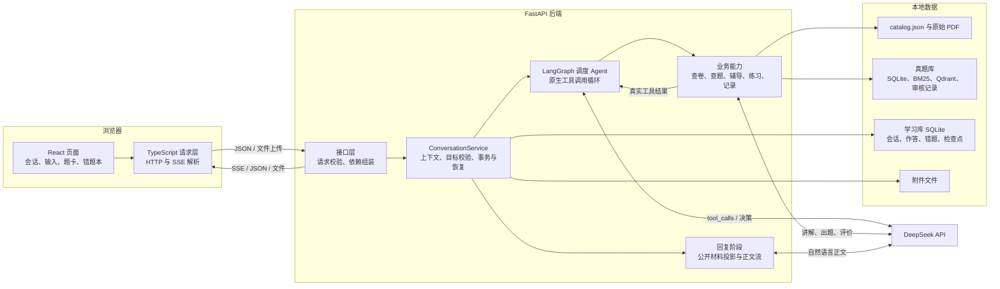
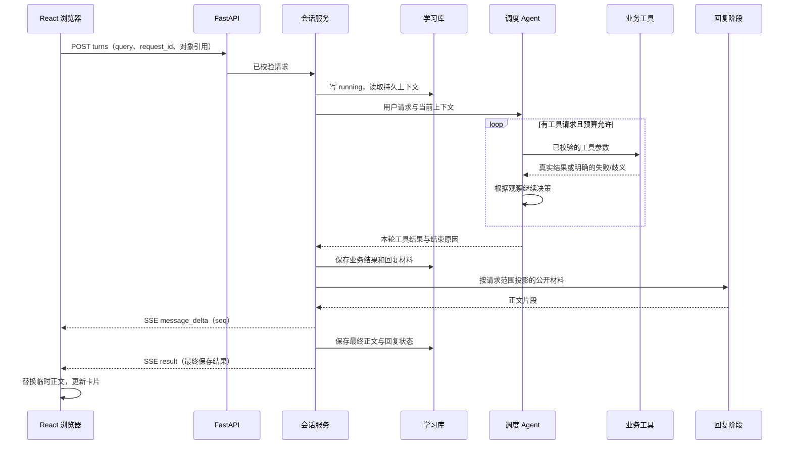
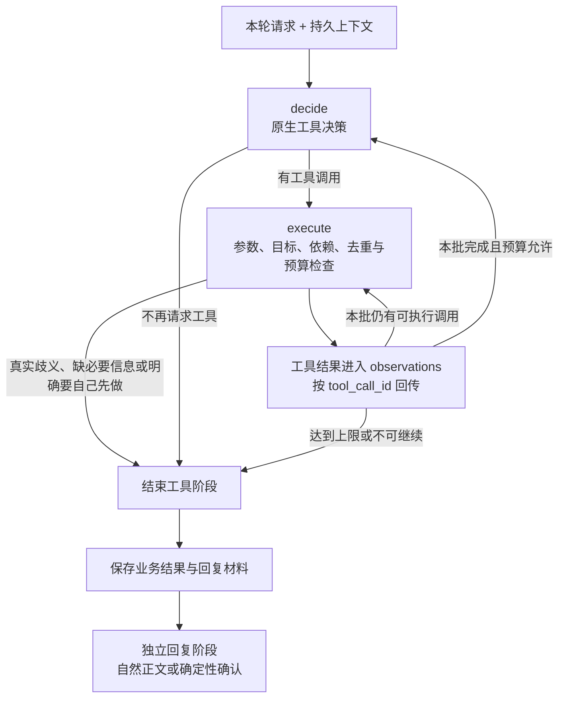
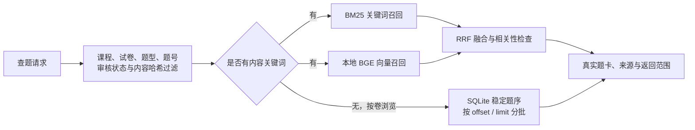

# 河海大学考试复习助手

面向河海大学学生的本地全栈 Agent 应用。在同一个学习会话中，学生可以查找试卷、定位 Python 真题、询问考点、提交图文题目、请求讲解、练习和整理错题。

前端使用 React + TypeScript，后端使用 FastAPI，LangGraph 组织原生工具调用循环。模型根据上下文选择能力，程序负责查询真实资料、检查目标与操作条件、保存结果，再把执行结果交回模型继续决策。

项目地址：[minimaod/hhu-exam-agent](https://github.com/minimaod/hhu-exam-agent)

**当前为本地原型，尚未部署在线服务。最新返修已完成实现与自检，用户重新体验验收待完成。仓库提供源码、试卷目录和工具代码；PDF、已构建题库、模型缓存、个人学习数据和真实 API 密钥需在本地准备。**

阅读入口：[全栈架构](#全栈架构) · [Agent 架构](#agent-架构) · [本地启动](#本地启动) · [检查与验证](#检查与验证) · [资料目录](#资料目录)

## 功能与边界

| 能力 | 当前实现 |
| --- | --- |
| 查卷与下载 | 根据课程别名、考试类型查询已登记目录，按登记 ID 下载本地 PDF |
| Python 真题 | 按内容、试卷、题型或原卷题号查题；支持整卷题型浏览、分批继续及换题 |
| 自然语言问答 | 围绕当前题问考点、要提示、解释题意或请求完整讲解；不要求使用固定口令 |
| 图文辅导 | 输入文字、上传或粘贴题图，题目不清楚时澄清；可结合学生答案和过程分析错误 |
| 按需练习 | 从当前题生成类似题、提交作答、评价、补充和订正；每次尝试独立保存 |
| 错题本 | 根据明确保存要求、按钮或对清晰保存建议的确认建立记录，回看与纠正题目、讲解和来源 |
| 持久会话 | 保存轮次、选题、作答、上下文与执行状态；刷新或重启后恢复 |
| 流式回复与恢复 | 展示处理进度和正文片段；业务重试保留已成功动作，正文可单独重新生成 |

本地 Python 数据快照：20 份试卷、285 页、1154 道题，其中 1152 道已批准发布（选择 788、填空 324、编程 40），另 2 道原卷选项异常题隔离。58 道没有原卷答案的题单独保留缺失标记，并提供独立解答，不冒充原卷答案。这是当前本地资料的覆盖范围，不代表全部年份的 Python 考试。

其余课程目前以试卷目录与原卷下载为主；题库能力按实际数据报告，不编造未建立的学科真题。Python 题库可按已有学年、学期和题号定位；通用试卷目录查询仍主要支持课程与考试类型，不能把题库定位能力等同于所有课程均支持任意年份或课程版本筛选。

长期薄弱点记忆、掌握度评估、题型统计、个性化复习计划、多用户登录与线上部署尚未实现。当前不提供会话删除；删除错题记录会保留原会话和题图。

## 全栈架构

### 各层如何配合

| 层 | 职责 | 主要代码 |
| --- | --- | --- |
| React 页面 | 管理当前会话、输入草稿、附件、作答与卡片；显示临时正文和服务端保存结果 | [components](frontend/src/components) |
| 前端请求层 | 发起 HTTP 请求、解析 POST 返回的 SSE 流、校验事件和处理取消/迟到响应 | [conversationsApi.ts](frontend/src/lib/conversationsApi.ts) |
| FastAPI 接口 | 用 Pydantic 校验请求，组装服务依赖，将业务结果转为 JSON、文件或 SSE 响应 | [api](app/api)、[main.py](app/main.py) |
| 会话业务层 | 校验请求去重、对象归属与版本，协调 Agent 和业务能力，维护检查点与持久化 | [service.py](app/conversations/service.py) |
| Agent 调度层 | 根据本轮请求、上下文和真实工具结果选择下一步 | [graph.py](app/conversations/graph.py)、[tools.py](app/conversations/tools.py) |
| 业务能力层 | 查卷、查题、读取来源、讲解、出题、评价与保存记录 | [papers](app/papers)、[questions](app/questions)、[tutoring](app/tutoring)、[mistakes](app/mistakes) |
| 数据访问层 | 读目录与题库；事务写入会话、作答、记录和恢复状态 | [repository.py](app/conversations/repository.py)、[question_bank](app/question_bank) |
| 模型适配层 | 构造 DeepSeek 客户端，分别支持原生工具调用、结构化辅导结果和流式正文 | [llm.py](app/llm.py)、[reply.py](app/conversations/reply.py) |



模型通过后端适配器调用，浏览器不持有 API 密钥，也不直接访问模型、SQLite、Qdrant 或磁盘文件。Qdrant 使用本地存储模式，当前无需单独启动向量数据库服务器。

### 一次请求的数据流

以“给出刚刚那张卷的选择题第五题，说明它考什么”为例：

1. 前端向会话轮次接口提交文字、conversation_id 和唯一 request_id；若有图片，先上传附件，再在轮次里引用附件 ID。
2. FastAPI 校验参数。会话服务检查重复请求与运行冲突，先保存 running 轮次，读取已确认课程、最近明确试卷、当前题目和浏览位置。
3. 调度 Agent 选择工具。程序将“试卷 + 题型 + 原卷题号”解析为实际目标，检查来源和唯一性；跨页题号可重新定位，同号多题型才要求澄清。
4. 工具结果回到 Agent。它可以继续读取材料或决定本轮已有足够信息回答；选题成功不会自动强制学生先作答。
5. 业务结果与回复恢复材料先落库。回复阶段取得本轮允许使用的题面、来源和结果，生成考点说明；纯选题只确认真实目标。
6. 前端收到 message_delta 时展示临时正文，收到最终 result 后以服务端保存正文和卡片替换临时内容；刷新通过 GET 会话详情恢复。

下面展示通常需要生成正文时的时序，具体工具步骤由请求决定：



SSE 是一次 HTTP 请求的流式响应。前端请求层读取响应体并解析事件，不依赖 WebSocket。HTTP 200 只表示流已建立，业务是否完成要看最终事件和服务端记录。确定性澄清和纯选题确认可直接形成正文，无需额外调用回复模型。

### 数据放在哪里

| 数据 | 用途与写入方式 |
| --- | --- |
| data/papers/catalog.json | 试卷登记事实：课程、学年、考试类型、标题、相对 PDF 路径 |
| data/papers 下的 PDF | 原始资料；后端校验登记 ID、文件路径及来源后提供下载或原页 |
| data/local/question-bank | 版本化题目事实库、索引、题图、模型缓存与审核记录；运行时只返回已批准且内容哈希匹配的题 |
| data/local/study.sqlite3 | 可写学习库：会话、轮次、题目版本、选题与查看事实、练习和作答、错题、恢复检查点 |
| data/local/attachments | 用户上传的题目和解法图片；数据库保存元数据与关联 |

真题事实库和学习库是两个用途不同的 SQLite 数据源。前者描述“原卷是什么”，后者记录“这个会话做了什么”；不把模型生成的解答写回成原卷答案。已请求的讲解正文、作答与恢复材料会保存在学习库中。

### 代码导航

```text
app/
├─ main.py                    # 启动配置、数据库初始化、路由与异常处理
├─ api/                       # HTTP、文件与 SSE 接口
├─ conversations/
│  ├─ graph.py                # LangGraph 循环和调度模型
│  ├─ tools.py                # 原生工具 Schema、参数校验与公开结果字段
│  ├─ protocol.py             # 工具与内部动作契约
│  ├─ service.py              # 业务协调、目标解析、恢复与回复材料
│  ├─ reply.py                # 独立流式正文
│  ├─ repository.py           # 学习库事务与持久化
│  └─ schema.py               # v5 结构与逐级迁移
├─ question_bank/             # 题目事实、BM25、向量检索与 RRF
├─ questions/                 # 会话内查题、来源、卡片与答案可见性
├─ papers/                    # 试卷目录、课程别名与下载
├─ tutoring/                  # 图文辅导、练习生成、作答评价
├─ mistakes/                  # 错题记录与修订
├─ querying/                  # 保留的无状态查询理解与工作流
└─ llm.py                     # DeepSeek 模型适配
frontend/
├─ src/components/            # 会话、正文、题卡、练习与错题页面
├─ src/lib/                   # 请求、SSE 解析与响应校验
└─ vite.config.ts             # 开发端口与 /api 代理
tools/question_bank/          # 抽取、校订、构建、评估与发布工具
tests/                        # 协议、业务、迁移、故障、模型替身与资料测试
```

## Agent 架构

### 一个调度 Agent，协调多种业务能力

当前使用一个 LangGraph 调度 Agent。各课程共用工具与规则，差异由课程能力和本地数据决定。辅导、出题和评价是调度器调用的业务能力；它们可以使用同一 DeepSeek 提供方的模型，但不各自维护独立的自主调度循环。

调度采用原生 Tool Calling：SchedulerAgent 通过 bind_tools 提供工具 Schema，接收模型返回的 tool_calls；程序校验名称和参数，将调用规范化为内部 ActionPlan。执行结果按 tool_call_id 返回 tool 消息，模型看到真实结果后再决定下一步。内部仍使用 Pydantic 契约，辅导等任务也会产生结构化结果；这与“让模型输出一段 JSON 动作清单作为调度协议”不同。

### 决策、执行、观察、再决策



“查到题”“选中题”是执行事实，不等于必须结束教学对话。问考点时可在同轮定位并回答；只要求选题时确认选中结果；确实无法唯一确定试卷或题型时才澄清。讲解、练习和保存由学生需求驱动，工具的实际材料与写入条件仍由程序检查。

### 工具与业务服务

| 原生工具 | 业务能力 | 主要执行位置 |
| --- | --- | --- |
| confirm_course | 确认当前课程 | 会话服务与上下文 |
| query_papers | 查试卷目录和下载入口 | PaperService |
| search_questions | 按内容、题型、试卷或题号查已审核真题 | QuestionRuntime / QuestionBankService |
| list_paper_questions | 按卷与题型浏览，返回真实总数、范围和续页位置 | 同上，使用有序浏览 |
| select_question | 选定实际题目，绑定来源与版本 | 会话服务与学习库 |
| explain_problem | 根据题目材料讲解，或按请求范围回答 | 辅导能力与公开材料问答 |
| answer_followup | 围绕当前题继续追问 | 辅导能力与会话上下文 |
| generate_exercise | 按当前材料生成类似练习并检查重复 | 练习生成能力 |
| evaluate_exercise | 评价作答，支持补充与订正 | 作答评价能力 |
| reveal_solution | 按需读取练习参考解答 | 练习服务与学习库 |
| show_question_answer | 按需查看真题参考答案 | 题目服务与查看事实 |
| save_mistake | 保存错题与来源、题目版本和反馈 | 记录服务与学习库 |
| record_feedback | 保存“我懂了”等自述反馈 | 学习库 |
| ask_user | 请求必要澄清 | 会话服务 |

模型无法直接写库或提供本地文件。是否找到资料、是否保存成功、当前题号及来源，都来自工具和程序实际结果。

### 真题检索与浏览



题库使用 SQLite 保存事实，BM25 处理关键词匹配，本地 BAAI/bge-small-zh-v1.5 编码查询并在 Qdrant 中检索向量，再用 RRF 融合排序；向量不可用时可按实际状态降级。按试卷和题号浏览不需要把卷名当作题干关键词做语义搜索。

题目带 question_id、build、内容哈希和来源轮次。会话服务的共用目标解析同时检查试卷、题型、原卷题号与唯一性，避免换卷后命中旧卷同号题，也区分“原卷第 5 题”和“列表第 5 个”。

### 上下文与回复阶段

| 信息 | 如何使用 |
| --- | --- |
| 已确认课程、当前题目与练习 | 从学习库恢复，供本轮决策使用 |
| 最近明确试卷、题型、查询条件与位置 | 保存于轮次结果中，用于“刚刚那张卷”“继续”“换一道”等后续请求 |
| 最近对话摘要 | 提供语境，不把全部会话历史无限放入提示词 |
| 本轮 observations | 告诉模型哪些调用真的成功、失败或缺信息 |
| 回复材料 | 由程序投影：真实结果、相关公开题面、已请求的讲解及本轮回答范围 |

调度阶段的模型文本不直接作为正文输出。工具阶段结束后，[reply.py](app/conversations/reply.py) 使用没有写入工具的独立回复调用组织正文；因此“模型准备做什么”和“实际做完什么”分开处理。

学生只问考点或要提示时，正文取得相关公开材料，不自动开启完整答案或建立完整讲解记录。纯选题只返回真实目标的简短确认；纯浏览保留题卡，正文只接收数量与范围，避免模型从公开题干擅自解题。确定性澄清和选题确认可不调用正文模型。

### 上限、持久化与恢复

- 每轮最多 4 次工具决策，每次响应最多接受 3 个工具调用，累计最多 4 次工具尝试；无效和被拒绝的调用也消耗预算。这是调度上限，辅导和最终回复的模型请求另计。
- 成功结果和失败结果都会进入后续观察；失败步骤的依赖不会继续冒充成功，有副作用的动作保留去重与检查点。
- “我懂了”记录为自述，不自动出题或保存，也不等于长期掌握度；歧义确认和拒绝按上下文处理。
- 业务结果与回复材料先保存，再输出正文片段。正文失败不会撤销已经成功的保存、选题或作答。
- 同一 request_id 的已结束请求直接回放结果。业务失败可用新的 request_id 与 retry_of 恢复，已成功动作不重做。
- 业务已完成但正文中断时，可只重新生成正文，不重新讲题、出题或保存记录；恢复材料在重新使用时仍按请求范围过滤。
- 后端重启后恢复已保存会话，遗留 running 轮次标为 interrupted，不自动再次调用模型。

运行状态、业务结果和回复完整性分别表达：轮次可以已经 completed、业务 succeeded，但 reply_status 仍为 failed 或 truncated；确定性确认未尝试回复模型时，reply_status 可以为空。前端据此提供相应恢复入口，不能仅凭 HTTP 200 或收到一段文字判定全部完成。

## 本地启动

### 1. 环境与模型配置

使用 Python 3.12、Node.js 24、uv 和 pnpm。Python 与前端依赖分别由 [uv.lock](uv.lock) 和 [pnpm-lock.yaml](frontend/pnpm-lock.yaml) 锁定。

将项目根目录的 [.env.example](.env.example) 复制为 .env，在本地填写密钥：

```dotenv
DEEPSEEK_API_KEY=your-api-key-here
DEEPSEEK_BASE_URL=https://api.deepseek.com
DEEPSEEK_MODEL=deepseek-flash
```

模型名称以本地配置为准。调度采用原生工具调用，辅导按任务使用结构化输出，回复采用文本流；后端模型适配默认关闭思考模式。环境变量优先于 .env，配置在后端启动时读取，修改后需重启。真实密钥仅在后端使用，不放入前端 VITE_* 变量。

缺少模型配置时，健康检查、手动目录查询和已保存历史仍可用；需要模型的新轮次会返回配置错误。

### 2. 启动后端

在项目根目录运行：

```powershell
uv sync
uv run uvicorn app.main:app --reload --host 127.0.0.1 --port 8000
```

接口文档：[http://127.0.0.1:8000/docs](http://127.0.0.1:8000/docs)。

### 3. 启动前端

另开终端：

```powershell
cd frontend
pnpm install
pnpm dev
```

打开 [http://127.0.0.1:5173](http://127.0.0.1:5173)。Vite 将 /api 代理到本地 8000 端口；生产部署入口需另行配置。

### 4. 准备资料与题库

| 运行范围 | 需要准备的数据 |
| --- | --- |
| 目录查询 | 仓库中的 data/papers/catalog.json |
| 原卷下载 | 按目录 file_path 将 PDF 放到 data/papers 对应位置；缺文件时下载返回 404 |
| 文字/图片辅导、练习 | 有效模型配置；用户提供题目材料，学习库由后端初始化 |
| Python 真题检索与来源回看 | 已构建的版本化题库、匹配的审核记录和模型缓存，以及来源 PDF |

**克隆源码不等于取得本地 1152 道已发布题。** data/local 已被忽略，题库索引、校订与审核数据不会随源码提交；只补齐 PDF 也不会自动生成已审核题库。没有题库时相应能力报告未建立或不可用，目录查询和原卷下载仍按各自条件工作。

题库准备流程是“抽取 → 校订与审核 → 构建和校验 → 发布”，相关工具位于 [tools/question_bank](tools/question_bank)。构建版本、题目内容与审核决定的哈希须一致；未经审核的候选不会作为正式真题返回。工具参数可分别查看：

```powershell
uv sync --group ingest
uv run python -m tools.question_bank.build --help
uv run python -m tools.question_bank.publish --help
uv run python -m tools.question_bank.search_cli --help
```

题库默认位于 data/local/question-bank，可通过进程环境变量 HHU_QB_ROOT 指定另一份完整题库。Qdrant 本地目录具有独占锁；测试或离线工具使用独立副本，不与正在运行的应用同时打开同一索引目录。切换已发布题库或修改配置后，让后端重新加载。

### 5. 学习数据与图片

首次启动创建 data/local/study.sqlite3；题目和解法图片保存在 data/local/attachments。环境变量 HHU_STUDY_DB 可指向另一份学习库。旧库按 v1→v2→v3→v4→v5 逐级迁移，失败回滚，不自动清空原文件；操作前备份数据库及附件。

需要空白学习环境时，可指定新的 HHU_STUDY_DB。data/local 下同时保存题库和学习数据，不应把删除整个目录作为常规重置学习记录的方式。

会话与错题保存在后端所在设备，不会自动跨设备同步。删除错题记录只删除记录及修订关联，保留原会话和图片；当前没有会话删除入口。后端启动时会清理超过 24 小时且没有被使用的待提交图片，不清理已提交题图。

图片支持 JPEG、PNG、GIF、WebP，按实际内容校验；单张最多 6 MiB，一轮最多 4 张、合计 20 MiB，单边不超过 8192 像素、总像素不超过 4000 万。图片和来源文件通过后端受控接口读取，校验会话与对象归属，不暴露磁盘路径。

## 使用示例

| 学生输入 | 处理方式 |
| --- | --- |
| 我要复习高数；给我期末试卷 | 确认课程后，后续目录查询沿用该课程 |
| 找一道 Python 循环选择真题 | 从已审核题库按内容与题型查题 |
| 给出这张卷全部选择题；继续 | 按已确定试卷浏览，说明总数、本次范围与续页位置 |
| 给出刚刚那张试卷的选择题第五题 | 同时定位试卷、题型和原卷题号；无需先翻到该页 |
| 这段代码考什么知识点 | 回答考点，不强制先作答，也不自动公开完整解法 |
| 只给提示，先别公布答案 | 根据公开材料提供提示，限制回答深度 |
| 讲解这道题；为什么这个选项不对 | 根据当前目标及请求范围解释 |
| 先让我自己做，不给答案 | 保留自主作答要求 |
| 保存这题，再来一道类似题 | 根据真实结果和依赖组合保存、生成练习 |
| 我懂了 | 保存自述反馈，不自动出题或加入错题本 |

也可上传或粘贴题目图片，提交自己的答案和过程。题目不清楚时先补充；纠正题干保留旧版本，新的讲解与具体版本关联。练习作答只追加，支持补充和订正；看过参考解答后作答会如实标注。

输入框 Enter 换行，Ctrl/⌘ + Enter 发送。处理中可以停止；之后以服务端已保存状态决定查看结果、只重做正文或重试业务。切换会话后，旧请求的迟到响应不能覆盖新会话草稿。

## 接口

| 接口 | 用途 |
| --- | --- |
| `GET /api/health` | 返回 `{"status":"ok","service":"hhu-exam-review"}` |
| `GET /api/papers` | 按可选 `course`、`exam_type` 查询，返回 `items`、`total` |
| `GET /api/papers/{paper_id}/download` | 按已登记 ID 返回 PDF 附件 |
| `POST /api/query` | 接收 `{"query":"找高数期末试卷"}`，通过 SSE 返回进度及最终结果（无会话状态） |
| `POST /api/conversations` | 接收空对象 `{}`，201 返回会话摘要 |
| `GET /api/conversations` | 返回 `items`、`total`，按更新时间降序、ID 稳定排序 |
| `GET /api/conversations/{id}` | 返回会话摘要和按顺序排列的全部轮次 |
| `POST /api/conversations/{id}/turns` | 提交一轮会话，通过 SSE 返回进度及最终结果；可选 `attempt_kind`（`supplement`/`correction`）和 `retry_of`（从失败轮次恢复重试） |
| `POST /api/conversations/{id}/turns/{request_id}/reply` | 只重新生成已保存轮次的正文，复用业务结果，不重跑工具 |
| `GET /api/conversations/{id}/questions/{qid}/source` | 按 build、题面/答案页类型和物理页读取原卷，校验来源 |
| `GET /api/conversations/{id}/questions/{qid}/assets/{aid}` | 读取该题已绑定的题图 |
| `GET /api/conversations/{id}/questions/{qid}/answer` | 按选题与查看权限读取参考答案 |
| `POST /api/conversations/{id}/exercises/{eid}/reveal` | 查看练习参考解答，并标记之后的作答为“已看解答后作答” |
| `POST /api/conversations/{id}/attachments` | `multipart/form-data` 上传题目/解法图片，返回附件元数据 |
| `GET /api/conversations/{id}/attachments/{aid}` | 读取会话内图片，校验归属，不返回磁盘路径 |
| `POST /api/mistake-records` | 把当前已讲解题目加入错题本；同一题重复请求返回已有记录 |
| `GET /api/mistake-records` | 分页返回错题列表，按创建时间降序 |
| `GET /api/mistake-records/{id}` | 返回题目、图片、来源、讲解、追问、反馈和修订摘要 |
| `PATCH /api/mistake-records/{id}` | 修改标题、来源、反馈或“我懂了”自述 |
| `POST /api/mistake-records/{id}/corrections` | SSE：纠正记录题干/图片/解法并重新讲解，旧讲解写入修订 |
| `POST /api/mistake-records/{id}/adopt-problem` | 把同一会话更新版本的已讲解内容复制进记录 |
| `DELETE /api/mistake-records/{id}` | 删除记录和修订，保留原会话与图片 |

`exam_type` 接受 `midterm`、`final`、`other`；省略或空白表示全部。非法非空值返回 422。列表按学年降序，同学年按考试日期降序，未知日期在后；学年为“未标注”的记录排在最后。“转专业”是课程，不是考试类型，其试卷类型记为“其他”。

保留的无状态 `POST /api/query` 接口接收 1–1000 字符的非空 query，返回 `progress/result/error`。统一学习会话使用 `POST /api/conversations/{id}/turns`，本轮文字上限 2000 字符，其 SSE 包含：

| 事件 | 前端用途 |
| --- | --- |
| `progress` | 显示当前处理阶段，例如查题或组织回复 |
| `message_delta` | 按递增 seq 拼接本轮临时正文，不当作已完整保存的最终回复 |
| `result` | 使用最终保存的正文、题卡、业务与回复状态刷新轮次，丢弃临时正文 |
| `error` | 显示执行失败与可恢复信息；不伪装为完整成功 |

正常连接只有一个最终事件。HTTP 200 不代表后续业务一定成功；断流或停止后读取服务端状态，业务完成而正文未完成时可只重做正文。调度模型的思考与工具协议不会当作 message_delta 直接输出。

会话轮次以 `query` 承载文字。页面统一输入使用 `kind: "auto"` 进入调度；省略 kind 保留旧查询语义，显式的补充、纠正、作答等请求仍按各自字段约定校验。题卡动作绑定 question_id 与 question_source_turn，避免点击历史卡却操作当前另一题。外层事件含 conversation_id、request_id 和 kind，结果可携带题目、讲解、练习、评价与动作结果；业务状态和 reply_status 分开表达。完整请求及响应结构以运行中的 [OpenAPI 文档](http://127.0.0.1:8000/docs) 和 [接口代码](app/api/conversations.py) 为准。

会话/辅导/记录的错误约定：会话、题目、附件或记录不存在返回 404；非法 ID、字段组合、未登记来源、跨会话附件或图片损坏返回 422；图片过大 413、格式不支持 415；重复 `request_id` 内容不同、运行中冲突、已有活动题目、题目未讲解或记录旧版本冲突返回 409；数据库不可用、结构不兼容或模型配置缺失返回 503。

结果或执行错误会先写入 SQLite，成功后才发送对应终止事件；保存失败发送 `STORAGE_UNAVAILABLE`，不会发送表示完成的结果。重复提交已结束的请求会回放已保存的结果或错误，不再次调用模型；已中断的请求没有可回放结果，返回 409，需使用新的 `request_id`。自动保存会话不会自动加入错题本；“已记录”只在记录写入成功后显示。

目录整体不可用返回 503；未知 ID、文件缺失、越界、非 PDF 或当前不可读返回 404。下载前检查可预见的读取问题，传输过程中发生的文件变化仍可能导致中断。模型故障通过安全错误信息反馈，不把认证信息或服务端磁盘路径返回页面。

PowerShell 查询示例：

```powershell
curl.exe "http://127.0.0.1:8000/api/health"
curl.exe -G --data-urlencode "course=高数" --data-urlencode "exam_type=final" "http://127.0.0.1:8000/api/papers"
```

中文参数使用 `--data-urlencode`，避免 Windows 控制台直接拼接 URL 时的编码问题。

## 检查与验证

在项目根目录运行后端测试：

```powershell
uv sync
uv run pytest tests -q
```

前端：

```powershell
cd frontend
pnpm test
pnpm typecheck
pnpm build
```

后端覆盖接口与字段校验、原生工具协议、调度循环、来源和目标绑定、会话持久化、v1→v5 迁移、答案可见性、练习作答、记录、去重、断流和恢复。前端用 Node 测试运行器覆盖请求与 SSE 解析，用 Vitest + Testing Library 覆盖组件交互、草稿和迟到响应。

完整后端测试还依赖本地 PDF、题库及部分冻结评估资料；源码仓库不包含这些数据，因此未补齐资源时不能期待完整回归全部通过。涉及真实题库的验证应使用独立副本，避免 Qdrant 目录锁冲突。部分文件锁测试使用 Windows API。

最近一次 F008 返修验证：

| 项目 | 结果与证据范围 |
| --- | --- |
| 后端完整回归 | 760 passed，0 failed、0 skipped；在独立学习库和正式题库副本上执行 |
| 返修专题回归 | 共 53 项，覆盖自然表达、目标唯一性、换卷、分页、回复材料和恢复 |
| 前端客户端与类型检查 | 37 项通过；TypeScript 检查通过 |
| 真实模型与浏览器 | 实跑代码考点追问、明确换卷、同题号歧义三类场景；本轮调用 8 次 |
| 前端 DOM 与生产构建 | 此前返修报告为 70 项 DOM 通过及构建通过；最新一轮未改前端，没有重复执行这两项 |
| 验收状态 | 本轮实现与自检完成，用户重新体验验收待确认；不代表全部自然表达均已验证 |

本轮直接修复和上述最终回归由导师在用户授权后执行；此前阶段含 Harness 实现与自检。项目同时用于学习 Agent 和全栈工程，区分实现、自检、复核和用户验收，不把有限样本表述为全部功能均已验证。

## 资料目录

目录快照（2026-10-25），共登记 **13 门课程、162 份试卷**。贡献前可展开对应课程，按完整题名中的学期、课程版本和卷别对照，避免重复。

| 课程大类 | 全部 | 期中 | 期末 | 其他 |
| --- | --- | --- | --- | --- |
| 高等数学 | 14 | 7 | 7 | 0 |
| 概率论与数理统计 | 12 | 6 | 6 | 0 |
| 几何与线性代数 | 33 | 5 | 28 | 0 |
| 复变函数与积分变换 | 12 | 1 | 11 | 0 |
| 离散数学 | 5 | 0 | 5 | 0 |
| 大学物理 | 13 | 6 | 7 | 0 |
| C语言程序设计 | 9 | 5 | 4 | 0 |
| Python语言程序设计 | 20 | 10 | 10 | 0 |
| 中国近现代史纲要 | 11 | 0 | 11 | 0 |
| 大学英语 | 5 | 1 | 4 | 0 |
| 思想道德与法治 | 7 | 0 | 7 | 0 |
| 马克思主义基本原理 | 11 | 0 | 11 | 0 |
| 转专业 | 10 | 0 | 0 | 10 |
| 合计 | 162 | 41 | 111 | 10 |

完整机器可读目录：[catalog.json](data/papers/catalog.json)。课程按大类归并，“高数”“线代”“复变”“大物”等别名由 `app/papers/courses.py` 处理。A/B、Ⅰ/Ⅱ 等版本主要保留在标题中，当前不提供精确版本筛选；上下册等附加条件仍受自然语言支持范围限制。

**收录和标注口径：**

- 以下 162 条来自已登记目录，不是完整的历年考试清单；未列出表示当前未登记，不表示对应考试一定存在。
- “题名标注附答案”仅根据目录题名判断，未逐份核验答案完整性；“题名未标注”不等于确定没有答案。
- 考试类型沿用目录字段。题名只写“课内考试”“考试卷”或未写期末，但目录归为期末的，标记“期末（待核对）”，欢迎提供分类依据。
- 部分高数题名写的是“2014级”等入学年级，保留原题名；这些记录的目录学年标记待核对，不把年级直接认定为考试学年。
- “转专业”与高等数学、几何与线性代数等课程平级；它不是考试类型，这 10 份试卷的类型记为“其他”，因此期中、期末筛选不会混入转专业卷。
- 本地另有 7 份未登记资料，单列在“待整理资料”中，不计入 162 条，不直接视为缺失。

**目录记录不等于文件已经公开提供。** 仓库不包含 PDF。运行者需按 `file_path` 准备本地文件，或维护与自己资料一致的目录；未准备对应文件时，下载返回 404。

### 已登记试卷明细

<details>
<summary>高等数学：14 份（期中 7 / 期末 7）</summary>

| 目录学年 | 目录考试类型 | 完整题名（含学期、版本及卷别） | 答案标注 |
| --- | --- | --- | --- |
| 2024-2025 | 期末 | 2024-2025学年第二学期《高等数学AⅡ》期末考试试题 | 题名未标注 |
| 2024-2025 | 期末 | 2024-2025学年第一学期《高等数学BⅠ》期末试题及答案 | 题名标注附答案 |
| 2022-2023 | 期中 | 2022-2023学年第一学期《高等数学BⅠ》期中试卷 | 题名未标注 |
| 2021-2022 | 期中 | 2021-2022学年第一学期《高等数学BⅠ》期中试卷 | 题名未标注 |
| 2018-2019（待核对） | 期中 | 2018级高等数学（上）期中试卷 | 题名未标注 |
| 2018-2019（待核对） | 期末 | 2018级高等数学（上）期末试卷 | 题名未标注 |
| 2017-2018（待核对） | 期中 | 2017级高等数学（上）期中试卷 | 题名未标注 |
| 2017-2018（待核对） | 期末 | 2017级高等数学（上）期末试卷 | 题名未标注 |
| 2016-2017（待核对） | 期中 | 2016级高等数学（上）期中试卷 | 题名未标注 |
| 2016-2017（待核对） | 期末 | 2016级高等数学（上）期末试卷 | 题名未标注 |
| 2015-2016（待核对） | 期中 | 2015级高等数学（上）期中试卷 | 题名未标注 |
| 2015-2016（待核对） | 期末 | 2015级高等数学（上）期末试卷 | 题名未标注 |
| 2014-2015（待核对） | 期中 | 2014级高等数学（上）期中试卷 | 题名未标注 |
| 2014-2015（待核对） | 期末 | 2014级高等数学（上）期末试卷 | 题名未标注 |

</details>

<details>
<summary>概率论与数理统计：12 份（期中 6 / 期末 6）</summary>

| 目录学年 | 目录考试类型 | 完整题名（含学期、版本及卷别） | 答案标注 |
| --- | --- | --- | --- |
| 2025-2026 | 期中 | 2025-2026学年第一学期《概率论与数理统计A》期中试卷 | 题名未标注 |
| 2024-2025 | 期中 | 2024-2025学年第一学期《概率论与数理统计A》期中试卷 | 题名未标注 |
| 2023-2024 | 期中 | 2023-2024学年第一学期《概率论与数理统计》期中试卷 | 题名未标注 |
| 2022-2023 | 期中 | 2022-2023学年第一学期《概率论与数理统计A》期中试卷及答案 | 题名标注附答案 |
| 2021-2022 | 期中 | 2021-2022学年第一学期《概率论与数理统计》期中试卷及答案 | 题名标注附答案 |
| 2021-2022 | 期末 | 2021-2022学年第一学期《概率论与数理统计A》期末试卷（A卷）及答案 | 题名标注附答案 |
| 2020-2021 | 期中 | 2020-2021学年第一学期《概率论与数理统计(A,B)》期中试卷 | 题名未标注 |
| 2020-2021 | 期末（待核对） | 2020-2021学年工科类《概率论与数理统计》试卷（含答案） | 题名标注附答案 |
| 2019-2020 | 期末（待核对） | 2019-2020学年工科类《概率论与数理统计》试卷（含答案） | 题名标注附答案 |
| 2019-2020 | 期末（待核对） | 2019-2020学年经管类《概率论与数理统计》试卷（含答案） | 题名标注附答案 |
| 2018-2019 | 期末（待核对） | 2018-2019学年工科类《概率论与数理统计》试卷（含答案） | 题名标注附答案 |
| 2018-2019 | 期末（待核对） | 2018-2019学年经管类《概率论与数理统计》试卷（含答案） | 题名标注附答案 |

</details>

<details>
<summary>几何与线性代数：33 份（期中 5 / 期末 28）</summary>

| 目录学年 | 目录考试类型 | 完整题名（含学期、版本及卷别） | 答案标注 |
| --- | --- | --- | --- |
| 2024-2025 | 期末 | 2024-2025学年第一学期《几何与线性代数》期末试卷 | 题名未标注 |
| 2023-2024 | 期中 | 2023-2024学年第二学期《几何与线性代数》期中试卷 | 题名未标注 |
| 2023-2024 | 期末 | 2023-2024学年第二学期《几何与线性代数》期末试卷（A卷）及答案 | 题名标注附答案 |
| 2022-2023 | 期中 | 2022-2023学年第二学期《几何与线性代数》期中试卷及答案 | 题名标注附答案 |
| 2022-2023 | 期末 | 2022-2023学年第二学期《几何与线性代数》期末试卷及答案 | 题名标注附答案 |
| 2020-2021 | 期中 | 2020-2021学年第二学期《几何与线性代数》期中试卷及答案 | 题名标注附答案 |
| 2020-2021 | 期中 | 2020-2021学年第一学期《几何与线性代数》期中试卷 | 题名未标注 |
| 2020-2021 | 期末 | 2020-2021学年第一学期《几何与线性代数》期末试卷及答案 | 题名标注附答案 |
| 2018-2019 | 期中 | 2018-2019学年第二学期《几何与线性代数》期中试卷（A卷）及答案 | 题名标注附答案 |
| 2018-2019 | 期末 | 2018-2019学年第二学期《几何与线性代数》期末试卷及答案 | 题名标注附答案 |
| 2017-2018 | 期末 | 2017-2018学年第二学期《几何与线性代数》期末试卷（A卷）及答案 | 题名标注附答案 |
| 2017-2018 | 期末（待核对） | 2017-2018学年第一学期《几何与线性代数》课内考试卷（A卷）及答案 | 题名标注附答案 |
| 2016-2017 | 期末（待核对） | 2016-2017学年第二学期《几何与线性代数》课内考试卷（A卷）及答案 | 题名标注附答案 |
| 2016-2017 | 期末 | 2016-2017学年第二学期《几何与线性代数》期末试卷（A卷）及答案 | 题名标注附答案 |
| 2016-2017 | 期末（待核对） | 2016-2017学年第一学期《几何与线性代数》课内考试卷（A卷）及答案 | 题名标注附答案 |
| 2015-2016 | 期末（待核对） | 2015-2016学年第二学期《几何与线性代数》考试卷（A卷）及答案 | 题名标注附答案 |
| 2015-2016 | 期末（待核对） | 2015-2016学年第二学期《几何与线性代数》课内考试卷（A卷）及答案 | 题名标注附答案 |
| 2015-2016 | 期末 | 2015-2016学年第二学期《几何与线性代数》期末试卷（A卷）及答案 | 题名标注附答案 |
| 2015-2016 | 期末（待核对） | 2015-2016学年第一学期《几何与线性代数》课内考试卷（A卷）及答案 | 题名标注附答案 |
| 2014-2015 | 期末（待核对） | 2014-2015学年第二学期《几何与线性代数》课内考试卷（A卷）及答案 | 题名标注附答案 |
| 2014-2015 | 期末 | 2014-2015学年第二学期《几何与线性代数》期末试卷（A卷）及答案 | 题名标注附答案 |
| 2013-2014 | 期末（待核对） | 2013-2014学年第二学期《几何与线性代数》课内考试卷（A卷）及答案 | 题名标注附答案 |
| 2013-2014 | 期末 | 2013-2014学年第二学期《几何与线性代数》期末试卷及答案 | 题名标注附答案 |
| 2013-2014 | 期末（待核对） | 2013-2014学年第一学期《几何与线性代数》课内考试卷（A卷）及答案 | 题名标注附答案 |
| 2012-2013 | 期末 | 2012-2013学年第二学期《几何与线性代数》期末试卷（A卷）及答案 | 题名标注附答案 |
| 2012-2013 | 期末（待核对） | 2012-2013学年第一学期《几何与线性代数》课内考试卷（A卷）及答案 | 题名标注附答案 |
| 2011-2012 | 期末 | 2011-2012学年第二学期《几何与线性代数》期末试卷（A卷）及答案 | 题名标注附答案 |
| 2010-2011 | 期末 | 2010-2011学年第二学期《几何与线性代数》期末试卷及答案 | 题名标注附答案 |
| 2009-2010 | 期末 | 2009-2010学年第二学期《几何与线性代数》期末试卷及答案 | 题名标注附答案 |
| 2008-2009 | 期末 | 2008-2009学年第二学期《几何与线性代数》期末试卷及答案 | 题名标注附答案 |
| 2007-2008 | 期末 | 2007-2008学年第二学期《几何与线性代数》期末试卷及答案 | 题名标注附答案 |
| 2006-2007 | 期末 | 2006-2007学年第二学期《几何与线性代数》期末试卷及答案 | 题名标注附答案 |
| 2005-2006 | 期末 | 2005-2006学年第二学期《几何与线性代数》期末试卷及答案 | 题名标注附答案 |

</details>

<details>
<summary>复变函数与积分变换：12 份（期中 1 / 期末 11）</summary>

| 目录学年 | 目录考试类型 | 完整题名（含学期、版本及卷别） | 答案标注 |
| --- | --- | --- | --- |
| 2021-2022 | 期中 | 2021-2022学年第二学期《复变函数与积分变换》期中试卷及答案 | 题名标注附答案 |
| 2021-2022 | 期末 | 2021-2022学年第一学期《复变函数与积分变换A》期末试卷（B卷）及答案 | 题名标注附答案 |
| 2020-2021 | 期末 | 2020-2021学年第一学期《复变函数与积分变换》期末试卷（A卷）及答案 | 题名标注附答案 |
| 2016-2017 | 期末 | 2016-2017学年第一学期《复变函数与积分变换B》期末试卷（A卷）及答案 | 题名标注附答案 |
| 2015-2016 | 期末 | 2015-2016学年第二学期《复变函数与积分变换》期末试卷（A卷）及答案 | 题名标注附答案 |
| 2015-2016 | 期末 | 2015-2016学年第一学期《复变函数与积分变换》期末试卷（A卷）及答案 | 题名标注附答案 |
| 2014-2015 | 期末 | 2014-2015学年第二学期《复变函数与积分变换B》期末试卷（A卷）及答案 | 题名标注附答案 |
| 2014-2015 | 期末 | 2014-2015学年第一学期《复变函数与积分变换》期末试卷（A卷）及答案 | 题名标注附答案 |
| 2014-2015 | 期末 | 2014-2015学年第一学期《复变函数与积分变换》期末试卷（B卷）及答案 | 题名标注附答案 |
| 2013-2014 | 期末 | 2013-2014学年第一学期《复变函数与积分变换》期末试卷（A卷）及答案 | 题名标注附答案 |
| 2013-2014 | 期末 | 2013-2014学年第一学期《复变函数与积分变换》期末试卷（B卷） | 题名未标注 |
| 2003-2004 | 期末 | 2003-2004学年第二学期《复变函数与积分变换》期末试卷（B卷） | 题名未标注 |

</details>

<details>
<summary>离散数学：5 份（期中 0 / 期末 5）</summary>

| 目录学年 | 目录考试类型 | 完整题名（含学期、版本及卷别） | 答案标注 |
| --- | --- | --- | --- |
| 2022-2023 | 期末 | 2022-2023学年第一学期《离散数学》期末试卷 | 题名未标注 |
| 2020-2021 | 期末 | 2020-2021学年第一学期《离散数学》期末试卷（A卷） | 题名未标注 |
| 2020-2021 | 期末 | 2020-2021学年第一学期《离散数学》期末试卷（C卷）及答案 | 题名标注附答案 |
| 2019-2020 | 期末 | 2019-2020学年第一学期《离散数学》期末试卷（B卷） | 题名未标注 |
| 2018-2019 | 期末 | 2018-2019学年第一学期《离散数学》期末试卷（B卷） | 题名未标注 |

</details>

<details>
<summary>大学物理：13 份（期中 6 / 期末 7）</summary>

| 目录学年 | 目录考试类型 | 完整题名（含学期、版本及卷别） | 答案标注 |
| --- | --- | --- | --- |
| 2024-2025 | 期中 | 2024-2025学年第二学期《大学物理AI》期中试卷 | 题名未标注 |
| 2023-2024 | 期中 | 2023-2024学年第二学期《大学物理AI》期中试卷及答案 | 题名标注附答案 |
| 2022-2023 | 期末 | 2022-2023学年第一学期《大学物理AII》期末试卷 | 题名未标注 |
| 2021-2022 | 期中 | 2021-2022学年第一学期《大学物理AII》期中试卷及答案 | 题名标注附答案 |
| 2020-2021 | 期中 | 2020-2021学年第二学期《大学物理AI》期中试卷 | 题名未标注 |
| 2020-2021 | 期中 | 2020-2021学年第一学期《大学物理AI》期中试卷（力学综合测试） | 题名未标注 |
| 2020-2021 | 期中 | 2020-2021学年第一学期《大学物理AII》期中试卷及答案 | 题名标注附答案 |
| 2020-2021 | 期末 | 2020-2021学年第一学期《大学物理II》期末试卷（A卷）及答案 | 题名标注附答案 |
| 2019-2020 | 期末 | 2019-2020学年第一学期《大学物理II》期末试卷（A卷）及答案 | 题名标注附答案 |
| 2018-2019 | 期末 | 2018-2019学年第二学期《大学物理BI》期末试卷（A卷）及答案 | 题名标注附答案 |
| 2017-2018 | 期末 | 2017-2018学年第二学期《大学物理BI》期末试卷（A卷）及答案 | 题名标注附答案 |
| 2017-2018 | 期末 | 2017-2018学年第一学期《大学物理II》期末试卷（A卷）及答案 | 题名标注附答案 |
| 2014-2015 | 期末 | 2014-2015学年第一学期《大学物理II》期末试卷（A卷）及答案 | 题名标注附答案 |

</details>

<details>
<summary>C语言程序设计：9 份（期中 5 / 期末 4）</summary>

| 目录学年 | 目录考试类型 | 完整题名（含学期、版本及卷别） | 答案标注 |
| --- | --- | --- | --- |
| 2023-2024 | 期末 | 2023-2024学年第一学期《C语言程序设计》期末试卷（A卷）及答案 | 题名标注附答案 |
| 2022-2023 | 期中 | 2022-2023学年第一学期《C语言程序设计》期中试卷及答案 | 题名标注附答案 |
| 2022-2023 | 期末 | 2022-2023学年第二学期《C语言程序设计》期末试卷（A卷） | 题名未标注 |
| 2021-2022 | 期中 | 2021-2022学年第一学期《C语言程序设计》期中试卷及答案 | 题名标注附答案 |
| 2021-2022 | 期末 | 2021-2022学年第二学期《C语言程序设计》期末试卷（A卷）及答案 | 题名标注附答案 |
| 2020-2021 | 期中 | 2020-2021学年第一学期《C语言程序设计》期中试卷及答案 | 题名标注附答案 |
| 2020-2021 | 期末 | 2020-2021学年第二学期《C语言程序设计》期末试卷（A卷）及答案 | 题名标注附答案 |
| 2019-2020 | 期中 | 2019-2020学年第一学期《C语言程序设计》期中试卷及答案 | 题名标注附答案 |
| 2018-2019 | 期中 | 2018-2019学年第一学期《C语言程序设计》期中试卷及答案 | 题名标注附答案 |

</details>

<details>
<summary>Python语言程序设计：20 份（期中 10 / 期末 10）</summary>

| 目录学年 | 目录考试类型 | 完整题名（含学期、版本及卷别） | 答案标注 |
| --- | --- | --- | --- |
| 2024-2025 | 期末 | 2024-2025学年第一学期《Python语言程序设计》期末试卷（A卷）及答案 | 题名标注附答案 |
| 2024-2025 | 期中 | 2024-2025学年第一学期《Python语言程序设计》期中试卷及答案 | 题名标注附答案 |
| 2024-2025 | 期末 | 2024-2025学年第二学期《Python语言程序设计》期末试卷（A卷）及答案 | 题名标注附答案 |
| 2024-2025 | 期中 | 2024-2025学年第二学期《Python语言程序设计》期中试卷及答案 | 题名标注附答案 |
| 2023-2024 | 期末 | 2023-2024学年第一学期《Python语言程序设计》期末试卷（A卷）及答案 | 题名标注附答案 |
| 2023-2024 | 期中 | 2023-2024学年第一学期《Python语言程序设计》期中试卷及答案 | 题名标注附答案 |
| 2023-2024 | 期末 | 2023-2024学年第二学期《Python语言程序设计》期末试卷（A卷）及答案 | 题名标注附答案 |
| 2023-2024 | 期中 | 2023-2024学年第二学期《Python语言程序设计》期中试卷 | 题名未标注 |
| 2022-2023 | 期末 | 2022-2023学年第一学期《Python语言程序设计》期末试卷（A卷）及答案 | 题名标注附答案 |
| 2022-2023 | 期中 | 2022-2023学年第一学期《Python语言程序设计》期中试卷及答案 | 题名标注附答案 |
| 2022-2023 | 期末 | 2022-2023学年第二学期《Python语言程序设计》期末试卷（A卷）及答案 | 题名标注附答案 |
| 2022-2023 | 期中 | 2022-2023学年第二学期《Python语言程序设计》期中试卷及答案 | 题名标注附答案 |
| 2021-2022 | 期末 | 2021-2022学年第一学期《Python语言程序设计》期末试卷（A卷）及答案 | 题名标注附答案 |
| 2021-2022 | 期中 | 2021-2022学年第一学期《Python语言程序设计》期中试卷及答案 | 题名标注附答案 |
| 2021-2022 | 期末 | 2021-2022学年第二学期《Python语言程序设计》期末试卷（A卷）及答案 | 题名标注附答案 |
| 2021-2022 | 期中 | 2021-2022学年第二学期《Python语言程序设计》期中试卷及答案 | 题名标注附答案 |
| 2020-2021 | 期末 | 2020-2021学年第一学期《Python语言程序设计》期末试卷（A卷）及答案 | 题名标注附答案 |
| 2020-2021 | 期中 | 2020-2021学年第一学期《Python语言程序设计》期中试卷及答案 | 题名标注附答案 |
| 2020-2021 | 期末 | 2020-2021学年第二学期《Python语言程序设计》期末试卷（A卷）及答案 | 题名标注附答案 |
| 2020-2021 | 期中 | 2020-2021学年第二学期《Python语言程序设计》期中试卷及答案 | 题名标注附答案 |

</details>

<details>
<summary>中国近现代史纲要：11 份（期中 0 / 期末 11）</summary>

| 目录学年 | 目录考试类型 | 完整题名（含学期、版本及卷别） | 答案标注 |
| --- | --- | --- | --- |
| 2020-2021 | 期末 | 2020-2021学年第一学期《中国近现代史纲要》期末试卷（A卷）版本1 | 题名未标注 |
| 2020-2021 | 期末 | 2020-2021学年第一学期《中国近现代史纲要》期末试卷（A卷）版本2 | 题名未标注 |
| 2020-2021 | 期末 | 2020-2021学年第一学期《中国近现代史纲要》期末试卷（B卷） | 题名未标注 |
| 2019-2020 | 期末 | 2019-2020学年第一学期《中国近现代史纲要》期末试卷（A卷） | 题名未标注 |
| 2019-2020 | 期末 | 2019-2020学年第一学期《中国近现代史纲要》期末试卷（B卷） | 题名未标注 |
| 2018-2019 | 期末 | 2018-2019学年第一学期《中国近现代史纲要》期末试卷及答案（B卷） | 题名标注附答案 |
| 2018-2019 | 期末 | 2018-2019学年第一学期《中国近现代史纲要》期末试卷（C卷） | 题名未标注 |
| 2017-2018 | 期末 | 2017-2018学年第一学期《中国近现代史纲要》期末试卷（A卷） | 题名未标注 |
| 2016-2017 | 期末 | 2016-2017学年第一学期《中国近现代史纲要》期末试卷（A卷） | 题名未标注 |
| 2016-2017 | 期末 | 2016-2017学年第一学期《中国近现代史纲要》期末试卷（C卷） | 题名未标注 |
| 2016-2017 | 期末 | 2016-2017学年第二学期《中国近现代史纲要》期末试卷（A卷） | 题名未标注 |

</details>

<details>
<summary>大学英语：5 份（期中 1 / 期末 4）</summary>

| 目录学年 | 目录考试类型 | 完整题名（含学期、版本及卷别） | 答案标注 |
| --- | --- | --- | --- |
| 2023-2024 | 期中 | 2023-2024学年第二学期《大学英语II》期中试卷及答案 | 题名标注附答案 |
| 2023-2024 | 期末 | 2023-2024学年第二学期《大学英语II》期末试卷 | 题名未标注 |
| 2022-2023 | 期末 | 2022-2023学年第二学期《大学英语II》期末试卷及答案 | 题名标注附答案 |
| 2022-2023 | 期末 | 2022-2023学年第一学期《大学英语I》期末试卷及答案（A卷） | 题名标注附答案 |
| 2020-2021 | 期末 | 2020-2021学年第二学期《大学英语》期末试卷及答案（A卷） | 题名标注附答案 |

</details>

<details>
<summary>思想道德与法治：7 份（期中 0 / 期末 7）</summary>

| 目录学年 | 目录考试类型 | 完整题名（含学期、版本及卷别） | 答案标注 |
| --- | --- | --- | --- |
| 2023-2024 | 期末 | 2023-2024学年第一学期《思想道德与法治》期末试卷 | 题名未标注 |
| 2022-2023 | 期末 | 2022-2023学年第一学期《思想道德与法治》期末试卷 | 题名未标注 |
| 2020-2021 | 期末 | 2020-2021学年第二学期《思想道德与法治》期末试卷及答案（A卷） | 题名标注附答案 |
| 2019-2020 | 期末 | 2019-2020学年第二学期《思想道德与法治》期末试卷及答案（A卷） | 题名标注附答案 |
| 2019-2020 | 期末 | 2019-2020学年第一学期《思想道德与法治》期末试卷（C卷） | 题名未标注 |
| 2018-2019 | 期末 | 2018-2019学年第一学期《思想道德与法治》期末试卷及答案（B卷） | 题名标注附答案 |
| 2017-2018 | 期末 | 2017-2018学年第二学期《思想道德与法治》期末试卷及答案（B卷） | 题名标注附答案 |

</details>

<details>
<summary>马克思主义基本原理：11 份（期中 0 / 期末 11）</summary>

| 目录学年 | 目录考试类型 | 完整题名（含学期、版本及卷别） | 答案标注 |
| --- | --- | --- | --- |
| 2023-2024 | 期末 | 2023-2024学年第一学期《马克思主义基本原理》期末试卷（A卷） | 题名未标注 |
| 未标注 | 期末 | 《马克思主义基本原理概论》期末试卷及答案（第01套） | 题名标注附答案 |
| 未标注 | 期末 | 《马克思主义基本原理概论》期末试卷及答案（第02套） | 题名标注附答案 |
| 未标注 | 期末 | 《马克思主义基本原理概论》期末试卷及答案（第03套） | 题名标注附答案 |
| 未标注 | 期末 | 《马克思主义基本原理概论》期末试卷及答案（第04套） | 题名标注附答案 |
| 未标注 | 期末 | 《马克思主义基本原理概论》期末试卷及答案（第05套） | 题名标注附答案 |
| 未标注 | 期末 | 《马克思主义基本原理概论》期末试卷及答案（第06套） | 题名标注附答案 |
| 未标注 | 期末 | 《马克思主义基本原理概论》期末试卷及答案（第07套） | 题名标注附答案 |
| 未标注 | 期末 | 《马克思主义基本原理概论》期末试卷及答案（第08套） | 题名标注附答案 |
| 未标注 | 期末 | 《马克思主义基本原理概论》期末试卷及答案（第09套） | 题名标注附答案 |
| 未标注 | 期末 | 《马克思主义基本原理概论》期末试卷及答案（第10套） | 题名标注附答案 |

</details>

<details>
<summary>转专业：10 份（其他 10）</summary>

| 目录学年 | 目录考试类型 | 完整题名（含学期、版本及卷别） | 答案标注 |
| --- | --- | --- | --- |
| 2025 | 转专业 | 2025年河海大学转专业《专业综合测试（自动化）》试卷（回忆版） | 题名未标注 |
| 2024 | 转专业 | 2024年河海大学转专业《专业综合测试（计算机与软件学院）》面试真题汇总 | 题名未标注 |
| 2024 | 转专业 | 2024年河海大学转专业《大学英语》试卷（回忆版） | 题名未标注 |
| 2024 | 转专业 | 2024年河海大学转专业《高等数学》试卷（回忆版） | 题名未标注 |
| 2022 | 转专业 | 2022年河海大学转专业《大学语文》试卷（回忆版） | 题名未标注 |
| 2021 | 转专业 | 2021年河海大学转专业《大学英语》试卷 | 题名未标注 |
| 2021 | 转专业 | 2021年河海大学转专业《高等数学B（工科）》试卷 | 题名未标注 |
| 2019-2022 | 转专业 | 2019-2022级河海大学转专业《高等数学（上册）》真题精选及答案 | 题名标注附答案 |
| 2019 | 转专业 | 2019年河海大学转专业《高等数学B（工科）》试卷 | 题名未标注 |
| 未标注 | 转专业 | 河海大学转专业《大学英语》真题题源截图（选词填空与阅读） | 题名未标注 |

</details>

### 优先补充方向

下表基于当前目录，列出优先征集方向。各学期、课程版本和卷别仍需分别核对；未登记不代表确定存在一场缺失考试，也不代表同学年已有一份资料就覆盖所有版本。

| 课程 | 当前优先补充方向 |
| --- | --- |
| 高等数学 | 2023-2024 学年资料；2024-2025 学年期中资料 |
| 概率论与数理统计 | 2022-2023、2023-2024、2024-2025、2025-2026 学年期末资料 |
| 几何与线性代数 | 2021-2022 学年资料；2024-2025 学年期中资料 |
| 复变函数与积分变换 | 2022-2023 至 2025-2026 学年资料 |
| 离散数学 | 2023-2024 至 2025-2026 等近年资料；若课程有期中考核，也欢迎补充相应试卷 |
| 大学物理 | 2023-2024、2024-2025 学年期末资料 |
| C语言程序设计 | 2024-2025 学年资料；2019-2020 学年期末完整试卷（现只有参考答案） |
| Python语言程序设计 | 2025-2026 学年资料 |
| 中国近现代史纲要 | 2021-2022 至 2025-2026 学年资料；近年期中资料 |
| 大学英语 | 2024-2025、2025-2026 学年资料，完整卷优先 |
| 思想道德与法治 | 2024-2025、2025-2026 学年资料 |
| 马克思主义基本原理 | 近年期末完整卷；现有 10 套题库缺少学年，欢迎补充出处 |
| 转专业 | 近年完整真题；回忆版与截图欢迎补充原始试卷 |

也欢迎补充未覆盖的课程、其他学期或版本、不同卷别、配套答案和更清晰的扫描件。已有记录如有课程、学年、考试类型或题名错误，也可提供更正依据。

### 待整理资料

下列文件本地已有但尚未登记，文件内容、是否重复及配套关系仍待核对。请先提供核对线索，避免重复提交相同文件：

| 本地文件名 | 当前状态 |
| --- | --- |
| 2020-2021学年第二学期《几何与线性代数》期末试卷（A卷）参考答案.pdf | 纯参考答案、无题目页，未单独登记；配套试卷待核对 |
| 2019-2020学年第一学期《C语言程序设计》期末试卷（A卷）参考答案.pdf | 纯参考答案、无题目页，未单独登记；配套完整试卷待核对 |
| 2017-2018学年第二学期《大学物理BI》期末试卷（B卷）参考答案.pdf | 纯参考答案，同场 A 卷已登记；未单独登记 |
| 2025-2026学年第一学期《大学物理AII》期中试卷参考答案.pdf | 纯参考答案，未单独登记；配套试卷待核对 |
| 2011级河海大学新生英语入学分级考试试卷及答案.pdf | 新生分级考试，不属于期中/期末，未登记 |
| 2023-2024学年第一学期《大学英语I》期末试卷（节选）.pdf | 节选缺页，未登记；收到完整卷后再补 |
| 河海大学《思想道德修养与法律基础》期末试卷.pdf | 旧课程名且无学年，未登记；确认学年后可按“思想道德与法治”补录 |

### 如何贡献资料

1. 先展开上述明细，核对课程版本、学年、学期、考试类型与卷别。
2. 通过仓库 [新建 Issue](https://github.com/minimaod/hhu-exam-agent/issues/new) 提供资料信息，标题可用“资料补充：课程 / 学年 / 考试类型”；更正已有资料时请附完整题名。
3. 维护者核对是否已收录及资料信息后，再确认 PDF 的具体交接方式。本仓库继续只提交源码和目录，不要求把 PDF 加入 Git 提交。

可复制以下内容填写；不确定的项目写“待确认”，无需猜测：

```text
课程及版本：
学年、学期：
考试类型、卷别：
是否附答案：
资料来源及可提供方式：
对应已有题名或补充说明：
```

## 参考项目

- [ecommerce-query-agent](https://github.com/minimaod/ecommerce-query-agent)：参考 React、FastAPI、SSE、LangGraph 及模块分层方式。
- [deepsearch-agents](https://github.com/didilili/deepsearch-agents)：参考 Python 3.12、Agent 工作流及前后端任务交互的组织方式。

实际引用的上游代码需保留对应来源及许可证信息。
